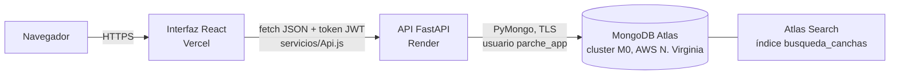
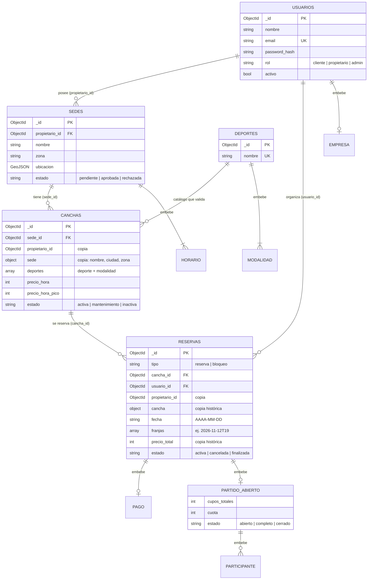
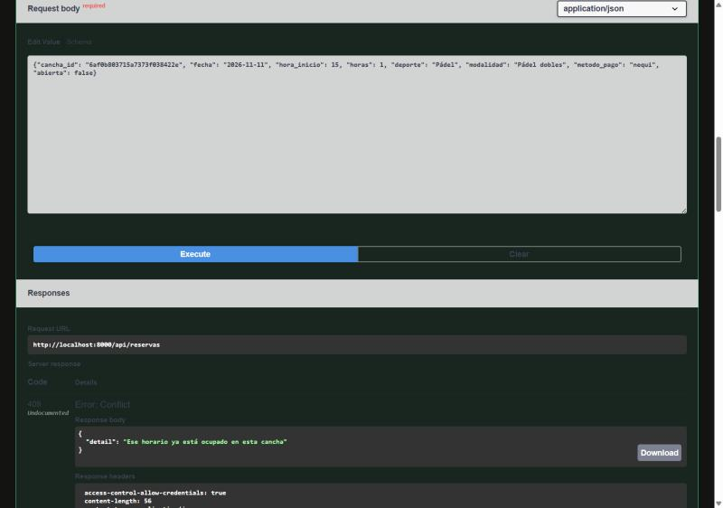
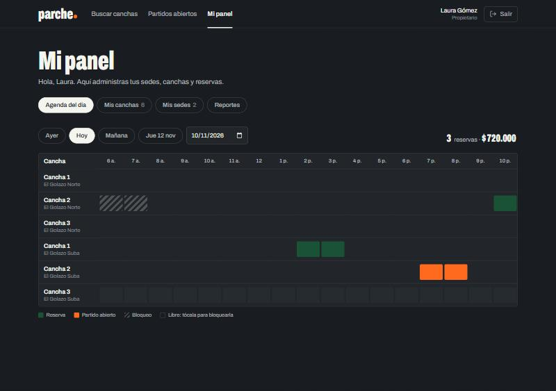
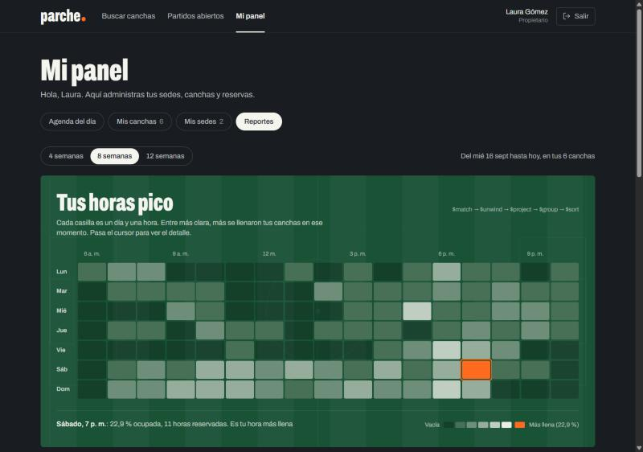
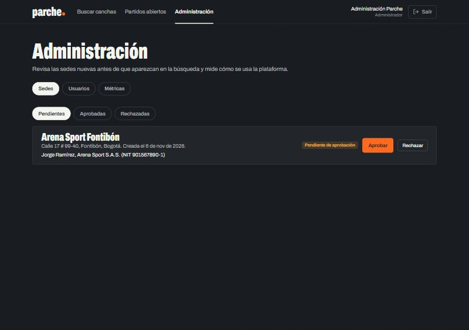
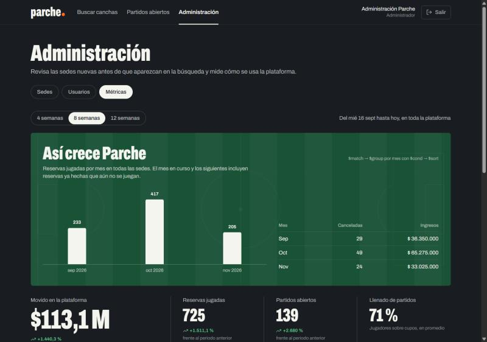

# Documento técnico — Parche

> **Reserva la cancha. Arma el parche.**
> Proyecto final de Bases de Datos II · Prof. Juan Carlos Gómez
> Integrantes: Juan Camilo Moreno, Marshall Robinson, Carlos Palacios
> Fecha: noviembre de 2026

| Enlace | Dirección |
|---|---|
| Repositorio | https://github.com/Juxn09/Parche |
| Aplicación (interfaz) | https://parche-six.vercel.app |
| API (documentación interactiva) | https://parche-akv4.onrender.com/docs |
| Estado de la API | https://parche-akv4.onrender.com/api/salud |

> La API usa el plan gratuito de Render: si nadie la usa durante 15 minutos se suspende, y la primera visita tarda cerca de un minuto en responder.

---

## 1. Problema y necesidad

En Bogotá y Medellín, reservar una cancha de fútbol 5, pádel, baloncesto, voleibol o tenis todavía se hace por WhatsApp o por teléfono. Eso trae varios problemas:

- **El jugador** no sabe qué canchas están libres a una hora determinada sin escribirle a cada sede. Además, cuando le faltan jugadores, el partido se cae.
- **El dueño de la cancha** lleva la agenda en un cuaderno o en un chat. Puede vender la misma hora dos veces y no sabe qué horas se llenan ni qué canchas rinden poco.
- **Nadie tiene información agregada**: qué deportes crecen, en qué zonas hay demanda, si los partidos abiertos se llenan.

Parche resuelve estos tres problemas en una sola plataforma.

## 2. Objetivo y alcance

**Objetivo general.** Construir un marketplace de reservas deportivas con la base de datos en la nube (MongoDB Atlas), una API y una interfaz web, que garantice la integridad de las reservas y ofrezca reportes útiles para el negocio.

**Objetivos específicos:**
1. Modelar los datos con documentos, justificando cuándo embeber y cuándo referenciar.
2. Garantizar en la propia base de datos que dos reservas nunca se crucen, también cuando hay peticiones simultáneas.
3. Ofrecer búsqueda y filtros por deporte, modalidad, ciudad, precio, techo y disponibilidad, con una búsqueda de texto tolerante a errores.
4. Implementar reglas de negocio reales: anticipación, cancelación, hora pico, partidos abiertos y aprobación de sedes.
5. Producir reportes con Aggregation Pipeline que respondan preguntas del negocio.
6. Desplegar la solución en internet sin exponer credenciales.

**Alcance.**

| Incluye | No incluye |
|---|---|
| Tres roles: jugador (cliente), propietario y administrador | Pagos reales: el pago es **simulado** |
| CRUD de sedes, canchas, reservas, bloqueos y usuarios | Notificaciones por correo o push |
| Partidos abiertos con cupos y cuotas | Aplicación móvil nativa (la web es *responsive*) |
| 9 reportes con Aggregation Pipeline y dashboard | Chat entre jugadores |
| Búsqueda con Atlas Search | |

## 3. Arquitectura



| Capa | Tecnología | Responsabilidad |
|---|---|---|
| Interfaz | React 19, Vite, Tailwind CSS 4, React Router | Mostrar, guiar y pedir. **Nunca** se conecta a MongoDB |
| API | Python, FastAPI, Pydantic, PyJWT, bcrypt | Validar, aplicar las reglas de negocio, autenticar y autorizar |
| Base de datos | MongoDB Atlas (base `parche`) | Guardar, validar con `$jsonSchema`, impedir cruces con un índice único y agregar |

**Analogía:** la interfaz es la **vitrina**, la API es el **mostrador** donde se decide qué se puede hacer, y Atlas es la **bodega**, que además tiene candados propios: la validación y el índice único.

**Tres capas de defensa.** La interfaz **orienta** (deshabilita horas ocupadas, oculta "Cancelar" si faltan menos de 24 h). La API **decide**, usando la hora del servidor. La base de datos **hace cumplir** lo crítico: el esquema y la unicidad. Si alguien se salta la interfaz con Postman, la API y la base siguen protegiendo los datos.

## 4. Por qué MongoDB Atlas

| Razón | En Parche |
|---|---|
| Los documentos se parecen a los objetos del negocio | Una reserva lleva embebidos su pago y su partido abierto con los participantes: se lee en una sola consulta |
| Esquema flexible pero validable | `$jsonSchema` con `validationLevel: strict` en las 5 colecciones |
| Índices potentes | Índice único **parcial** (solo reservas activas), índices compuestos y un índice 2dsphere para ubicación |
| Aggregation Framework | Los 9 reportes se calculan dentro de la base, sin traer miles de documentos a Python |
| **Atlas Search** (solo existe en Atlas) | Búsqueda que tolera errores de escritura y tildes |
| Servicio en la nube | Cluster gratuito M0, copias de seguridad administradas, lista de acceso por IP y TLS |

## 5. Modelo de datos



### 5.1 Colecciones

| Colección | Qué guarda | Documentos (datos de prueba) |
|---|---|---|
| `usuarios` | Jugadores, propietarios y administradores en una sola colección con el campo `rol` (**patrón polimórfico**: solo los propietarios tienen `empresa`) | 35 |
| `deportes` | Catálogo de deportes con sus modalidades y el número de jugadores | 5 |
| `sedes` | Lugares físicos de cada propietario, con ubicación GeoJSON, horario y servicios | 8 |
| `canchas` | Cada cancha (puede ser multiuso), con precios normal y de hora pico | 23 |
| `reservas` | Reservas de los jugadores **y** bloqueos del propietario (campo `tipo`) | 964 |

> Conteos tomados de `GET /api/salud` en producción el 10 de noviembre de 2026.

### 5.2 Relaciones: Embedding vs Referencing

**Regla general:** se **embebe** lo que se lee junto y tiene tamaño acotado, y se **referencia** lo que tiene vida propia, crece sin límite o se consulta por separado. Todo documento de MongoDB tiene un límite de **16 MB**.

| Relación | Decisión | Por qué |
|---|---|---|
| Usuario → empresa | **Embebido** | Es 1:1 y se lee siempre con el propietario |
| Deporte → modalidades | **Embebido** | Son pocas y no tienen vida propia |
| Sede → horario y servicios | **Embebido** | Acotados (7 días) y se leen con la sede |
| Sede → propietario | **Referencia** (`propietario_id`) | Ambos existen por separado; además, `propietario_id` aísla los datos de cada dueño |
| Cancha → sede | **Referencia + copia** (*referencia extendida*) | La cancha es lo que se busca: se copian nombre, ciudad y zona de la sede para buscar sin `$lookup`. Si la sede cambia de nombre, la copia se sincroniza con `update_many` |
| Reserva → cancha y jugador | **Referencia + copia histórica** | Las reservas crecen sin límite. Se copian el precio y los nombres **del momento** de la reserva: si mañana sube el precio, el historial no cambia |
| Reserva → pago y partido abierto | **Embebido** | Nacen y mueren con la reserva |
| Partido abierto → participantes | **Embebido** | Acotado por los jugadores de la modalidad (en el catálogo actual, máximo 16: fútbol 8) |

**Decisión clave: bloqueos dentro de `reservas`.** Un bloqueo del propietario (mantenimiento o torneo) es un documento de `reservas` con `tipo: "bloqueo"`. Así el **mismo índice único** impide que un jugador reserve una hora bloqueada **y** que el propietario bloquee una hora ya reservada.

### 5.3 Índices

| Colección | Índice | Para qué |
|---|---|---|
| `reservas` | **`ux_cancha_franja_activa`**: único sobre `{cancha_id, franjas}` y **parcial** (`estado: "activa"`) | Ninguna reserva ni bloqueo activo se cruza en la misma cancha y hora. Al cancelar, la reserva deja de ser "activa" y la franja se libera sola |
| `reservas` | `ix_usuario_fecha`, `ix_propietario_fecha`, `ix_partidos_abiertos` | Mis reservas, la agenda del propietario y el listado de partidos |
| `usuarios` | `ux_email` (único), `ix_rol` | Un correo por cuenta; filtrar por rol |
| `deportes` | `ux_nombre` (único) | Catálogo sin duplicados |
| `sedes` | `ix_propietario`, `ix_estado_ciudad_zona`, `ix_ubicacion_geo` (2dsphere) | Mis sedes; búsqueda de sedes aprobadas; ubicación (preparado para búsqueda por cercanía) |
| `canchas` | `ix_sede`, `ix_propietario`, `ix_deporte_modalidad` | Filtros y `$lookup` |
| `canchas` | **Atlas Search `busqueda_canchas`**, con un analizador propio que pasa a minúsculas y quita tildes (`icuFolding`) | Búsqueda de texto tolerante a errores |

Todos se crean con scripts reproducibles: `backend/scripts/CrearColecciones.py` y `backend/scripts/CrearIndiceBusqueda.py`.

### 5.4 Validación en la base (`$jsonSchema`)

Cada colección tiene un validador con `validationLevel: "strict"` y `validationAction: "error"`. Por ejemplo, `usuarios.rol` solo admite `cliente`, `propietario` o `admin`, el `email` debe tener formato de correo, y `reservas.franjas` debe seguir el patrón `AAAA-MM-DDTHH`. Si alguien intenta insertar un documento inválido, **MongoDB lo rechaza** aunque no pase por la API.

`[[EVIDENCIA: captura de Compass rechazando un documento inválido — ya existe en la bóveda: "F2 - Validacion rechaza documento.png"]]`

## 6. Conexión entre el backend y la base de datos

- **Driver:** PyMongo, con **un solo `MongoClient`** para toda la API (`backend/app/BaseDatos.py`). PyMongo mantiene un *pool* de conexiones y las reutiliza.
- **Credenciales:** la cadena de conexión está en la variable `MONGODB_URI`.
  - En local sale de `backend/.env`, que **Git ignora**; en el repositorio solo está la plantilla `backend/.env.example`.
  - En Render se configura en el panel de variables de entorno.
- **Usuario de base de datos:** `parche_app`, con permisos **solo sobre la base `parche`** (`readWrite` + `dbAdmin`). Es el principio de **mínimo privilegio**.
- **Red:** lista de acceso de Atlas con `0.0.0.0/0`, porque Render no tiene IP fija. Lo compensan el usuario con mínimo privilegio, la contraseña fuera del código y el cifrado **TLS**.
- **Arranque:** si Atlas no responde, la API no arranca (`comprobar_conexion()` en `Main.py`). Así falla rápido y con un mensaje claro.

## 7. Funcionalidades

| Rol | Funcionalidad | Ruta en la interfaz |
|---|---|---|
| Todos | Portada con las canchas libres de esta noche, consultadas en vivo | `/` |
| Todos | Buscador con filtros (deporte, modalidad, ciudad, precio, techo, día y hora libre, orden) y búsqueda de texto con Atlas Search | `/` |
| Todos | Ficha de la cancha con la sede completa (`$lookup`) y la regleta de horas del día | `/canchas/:id` |
| Todos | Partidos abiertos que buscan jugadores | `/partidos` |
| Jugador | Reservar (de 1 a 3 horas) y opcionalmente **abrir el partido** | `/canchas/:id` |
| Jugador | Unirse a un partido pagando su cuota (actualización atómica) | `/partidos` |
| Jugador | Mis reservas: próximas, jugadas y canceladas; cancelar o salir de un partido | `/mis-reservas` |
| Propietario | Agenda del día en forma de planilla; bloquear y desbloquear horas | `/panel` → Agenda |
| Propietario | CRUD de canchas y sedes (las sedes nuevas quedan pendientes) | `/panel` → Mis canchas / Mis sedes |
| Propietario | Reportes: mapa de calor, ingresos, mejores clientes, uso y cancelaciones | `/panel` → Reportes |
| Admin | Aprobar o rechazar sedes; activar o desactivar usuarios | `/admin` |
| Admin | Métricas de la plataforma | `/admin` → Métricas |
| Todos | Registro (jugador o propietario con empresa) e inicio de sesión | `/registro`, `/ingresar` |

**CRUD por colección:**

| Colección | Crear | Leer | Actualizar | Eliminar |
|---|---|---|---|---|
| `usuarios` | Registro | `/api/auth/yo`, admin | Admin activa o desactiva | — (borrado lógico) |
| `sedes` | Propietario | Propietario y admin | Propietario (sincroniza las copias en canchas); admin aprueba | Propietario, solo si no tiene canchas |
| `canchas` | Propietario (valida el catálogo y los precios) | Público y propietario | Propietario (precio, estado, modalidades) | Propietario: se borra si no tiene historial; si lo tiene, se **desactiva** |
| `reservas` | Jugador (reserva) y propietario (bloqueo) | Jugador, propietario, reportes | Cancelar; unirse o salir de un partido | Bloqueo: se retira (borrado lógico) |

## 8. Reglas de negocio y validaciones

| Regla | Dónde se garantiza | Archivo |
|---|---|---|
| Dos reservas o bloqueos activos nunca ocupan la misma cancha y hora | **Base de datos**: índice único parcial. La API traduce el error a **409** | `Reservas.py` |
| Correo único | **Base de datos**: índice único → 409 | `Auth.py` |
| Tipos y campos obligatorios | **Base de datos**: `$jsonSchema`; y API: Pydantic → 422 | `CrearColecciones.py`, `Modelos.py` |
| No reservar en el pasado ni con más de 30 días de anticipación | API, con la hora del servidor (UTC-5) | `Reservas.py` |
| Solo dentro del horario de la sede y si la cancha está activa | API | `Reservas.py` |
| El precio lo calcula el servidor; hora pico de 6 a 10 p. m. | API | `Utilidades.py` |
| Cancelar solo con 24 h de anticipación, y solo el organizador | API + actualización condicionada a `estado: activa` | `Reservas.py` |
| Partido abierto: modalidad de al menos 4 jugadores; cuota = precio ÷ jugadores, redondeada a la centena | API | `Reservas.py` |
| Unirse: hasta 2 h antes, sin superar el cupo, sin repetir jugador y sin que el organizador se una a su propio partido | **Actualización atómica** (`find_one_and_update` con `$expr` y `$push`) | `Partidos.py` |
| Salir de un partido con 24 h de anticipación devuelve la cuota | API | `Partidos.py` |
| Cada propietario solo ve y modifica lo suyo; lo ajeno responde 404 | API: `propietario_id` sale del **token**, nunca de la petición | `Propietario.py` |
| Solo aparecen en la búsqueda las sedes aprobadas | API | `Canchas.py` |
| La modalidad debe pertenecer al deporte según el catálogo | API | `Propietario.py` |
| El precio de hora pico no puede ser menor que el normal | API | `Propietario.py` |
| Una cancha con reservas futuras no se elimina ni pasa a mantenimiento | API | `Propietario.py` |
| Nadie puede registrarse como administrador | API: Pydantic solo admite `cliente` o `propietario` | `Modelos.py` |
| Las canchas de un propietario desactivado no aparecen ni se pueden reservar | API | `Utilidades.py` (`propietarios_inactivos`) |
| Rechazar una sede con reservas futuras exige confirmación; las reservas existentes se respetan | API: responde 409 y luego acepta `confirmar: true` | `Admin.py` |
| Una reserva que ya terminó pasa de `activa` a `finalizada` | API, con una función idempotente (ruta del admin y script) | `CicloDeVida.py` |

**Por qué el cruce de reservas no se revisa con un `if`.** Si la API consultara primero "¿está libre?" y luego insertara, dos personas que reservan en el mismo instante pasarían ambas la consulta. Con el índice único, la base de datos acepta la primera inserción y rechaza la segunda: es imposible que se crucen.

**Esto está probado automáticamente**: 6 reservas simultáneas de la misma hora dan exactamente un 201 y cinco 409 (ver la sección 8.1).

`[[EVIDENCIA: salida de "python -m pytest" con 54 pruebas aprobadas]]`

**Seguridad:**
- Las contraseñas se guardan con **bcrypt**: hash lento con sal, que no se puede revertir.
- La sesión usa **JWT** firmado (HS256) con una duración de 8 h.
- Cada petición vuelve a consultar al usuario, así que si el admin lo desactiva su token deja de servir al instante.
- **CORS** solo admite la dirección de la interfaz.

**Manejo de errores.** Todos los errores llegan a la interfaz en JSON y en español:
- La validación (422) traduce los mensajes de Pydantic. Por ejemplo, *"El tipo de cuenta debe ser una de estas opciones: cliente o propietario"*.
- Si la base de datos no responde, la API contesta **503** *"La base de datos no está disponible en este momento"*, en vez de un 500 en texto plano.
- Un middleware propio (`Errores.py`) se registra **antes** que CORS, así que también estas respuestas llevan las cabeceras CORS y el navegador puede leerlas.
- En la interfaz:
  - un 401 con sesión iniciada cierra la sesión y lleva a *Ingresar* con el aviso "Tu sesión expiró";
  - cada petición tiene un tiempo máximo de 45 s;
  - un error de conexión se muestra distinto de un resultado vacío.

### 8.1 Pruebas automáticas

54 pruebas con **pytest** (`backend/pruebas/`) verifican las reglas críticas contra un **MongoDB 7.0 real y temporal**, levantado con `pymongo-inmemory`. Nunca tocan Atlas: un candado detiene todo si la base no es local o no se llama `parche_pruebas`. Cada prueba crea las colecciones con **los mismos** `$jsonSchema` e índices de `CrearColecciones.py`.

| Grupo | Qué se comprueba |
|---|---|
| Reservas | Precio pico calculado por el servidor; cruce parcial rechazado (7 a 9 contra 8 a 9); otra cancha a la misma hora sí se permite; cancelar libera la franja; bloqueos y reservas no se cruzan en ningún sentido; **6 reservas simultáneas → 1 gana**; no se reserva en el pasado, a más de 30 días ni fuera de horario; cancelar exige 24 h; solo el organizador cancela |
| Partidos abiertos | Cuota = precio ÷ jugadores; no se supera el cupo, no se repite jugador y el organizador no se une a su partido; **5 uniones simultáneas a 3 cupos → exactamente 3**; salir devuelve el cupo; modalidades de menos de 4 jugadores no abren partido |
| Seguridad | Sin token 401, rol equivocado 403, token falso 401, usuario desactivado 401; nadie se registra como admin (422 en español); correo repetido 409 por el índice único |
| Multi-tenant | Un propietario no ve, edita, borra ni bloquea canchas de otro (404); la agenda solo trae reservas propias |
| Moderación | Las canchas de un propietario inactivo no aparecen ni se reservan; rechazar una sede con reservas pide confirmación |
| Datos | `finalizar_reservas_pasadas` es idempotente; `$jsonSchema` rechaza un documento inválido insertado directamente; un partido finalizado o cancelado rechaza unirse, salir y cancelar con un mensaje claro |
| Reportes | El reporte de deportes desempata alfabéticamente y su orden es estable |
| Libre hoy | Horas libres desde ahora (hora de Bogotá) hasta el cierre; casos de borde de cierre, sede cerrada, sin horas e ids inválidos |
| Paginación | "Cargar más" no repite ni pierde canchas, con empates de precio y nombre, en los dos órdenes y con filtros |

**¿Cómo sabemos que las pruebas sirven?** Se hizo una prueba de mutación: se quitó temporalmente la unicidad del índice `ux_cancha_franja_activa` y fallaron las 3 pruebas de cruce. Al restaurarlo, volvieron a pasar.

**Lo que las pruebas NO cubren.**
- **Atlas Search**: `$search` solo existe en Atlas, y el MongoDB temporal no lo tiene. Allí `$search` falla y la API usa el **respaldo con `$regex`**, así que las pruebas solo cubren ese respaldo. La búsqueda tolerante a errores ("golaso" → "El Golazo", "padel" → "Pádel") se verificó a mano contra Atlas, en local y en Render (sección 9).
- **Las pantallas**: se verifican a mano en el navegador.

**¿Por qué no `mongomock`?** Porque no aplica el índice único sobre arreglos (*multikey*): aceptaría una reserva de 8 a 9 encima de otra de 7 a 9.

## 9. Consultas y reportes

Todos los reportes se calculan con **Aggregation Pipeline** dentro de MongoDB (`backend/app/routers/Reportes.py`). Los de propietario filtran siempre por el `propietario_id` del token. Los pipelines completos, en sintaxis de mongosh para ejecutarlos en vivo, están en [`docs/Consultas.md`](Consultas.md).

| # | Pregunta de negocio | Para quién | Etapas | Utilidad |
|---|---|---|---|---|
| 1 | ¿Qué días y a qué horas se llenan mis canchas? | Propietario | `$match` → `$unwind` → `$project` (`$dayOfWeek`) → `$group` → `$sort` | Fijar promociones en las horas muertas y precios en las horas pico |
| 2 | ¿Cuánto factura cada sede por mes? | Propietario | `$match` → `$group` → `$project` → `$sort` | Comparar sedes. **Sin `$lookup`**, gracias a la copia `cancha.sede` |
| 3 | ¿Quiénes son mis 10 mejores clientes? | Propietario | `$group` → `$sort` → `$limit` → `$lookup` → `$unwind` | Fidelizar. El `$lookup` va **después** del `$limit`: solo busca 10 usuarios |
| 4 | ¿Qué cancha tiene más cancelaciones? | Propietario | `$group` con `$cond` → `$project` (`$round`) | Detectar problemas de una cancha |
| 5 | ¿Qué canchas casi no se usan? | Propietario | Parte de `canchas` → `$lookup` con `let`/`$expr`/`pipeline` → `$project` (`$size`, `$sum`) | Al partir de `canchas`, **también aparecen las que tienen cero reservas** |
| 6 | ¿Qué modalidades se reservan más? | Admin | `$match` → `$group` → `$sort` | Qué deportes promover |
| 7 | ¿Qué zonas tienen más demanda? | Admin | `$group` → `$sort` → `$limit` | Dónde buscar nuevos propietarios |
| 8 | ¿Se llenan los partidos abiertos? | Admin | `$project` → **`$facet`** (general y por deporte) → `$avg` | Medir si la función diferencial de Parche funciona |
| 9 | ¿Cómo crecen las reservas mes a mes? | Admin | `$group` con `$cond` → `$sort` | Tendencia de la plataforma |

**Cambio documentado en un reporte (10 de noviembre de 2026).** Al comparar los reportes antes y después de finalizar reservas, el reporte 6 salió una vez con **otro orden pero el mismo contenido**. La causa: `$sort: {reservas: -1}` no garantiza el orden entre modalidades **empatadas**. Se agregó un desempate alfabético, `$sort: {reservas: -1, modalidad: 1}`; es la única edición hecha a los pipelines de `Reportes.py`. La prueba `PruebaReportes.py` lo verifica: con dos modalidades empatadas, el orden es siempre el mismo en 5 consultas seguidas. Al quitar el desempate, la prueba falla.

**"Libre hoy" en la lista (`GET /api/canchas/libres-hoy?ids=...`).**
- **Qué hace:** devuelve las horas que quedan libres hoy en cada cancha, desde la hora actual de Bogotá (`ahora()`, UTC-5) hasta el cierre de su sede.
- **Límites:** acepta como máximo 50 ids (una página de la lista). Si se pasan más, o algún id es inválido, responde 400 con un mensaje claro.
- **Una sola consulta** sobre `reservas` para todas las canchas: filtra por `cancha_id ∈ ids`, `franjas ∈ franjas de hoy` y `estado: "activa"`. Son exactamente los campos del índice único `ux_cancha_franja_activa`.
- **`explain("executionStats")`, solo lectura, contra Atlas el 10 de noviembre:**

  | Medida | Con el índice | Sin índice (`$natural`) |
  |---|---|---|
  | Plan | `IXSCAN` sobre `ux_cancha_franja_activa` | Recorrido completo |
  | Claves examinadas | 27 | — |
  | Documentos examinados | **5** de 964 | 964 |
  | Tiempo | 9 ms | — |

- **Pruebas:** 15 casos de borde. Entre ellos: cerca del cierre, en la hora exacta, después del cierre, sede cerrada hoy, cancha sin horas, ids inválidos, vacíos, repetidos o de más, y que la fecha usada sea la de Bogotá y no la de UTC.
- **Si falla o tarda**, la lista se muestra igual, sin esa fila. Esto se comprobó en el navegador.

**Paginación ("Cargar más").** La lista pide páginas de 12 con `saltar`. Al orden de `GET /api/canchas` se le agregó `_id` como último criterio. Sin él, dos canchas empatadas en precio y nombre (por ejemplo, las dos "Cancha 2" de $160.000) podían cambiar de lugar entre páginas, y "Cargar más" repetiría una y perdería otra. Las pruebas de `PruebaPaginacion.py` recorren la lista página por página con distintos tamaños, órdenes y filtros, y comprueban que no se repita ni se pierda ninguna cancha. Al quitar el desempate, fallan 8 de 9.

**Resultados con los datos de prueba** (8 semanas):
- la hora más llena es el sábado a las 7 p. m., con 22,9 %;
- el mejor cliente tiene 14 reservas;
- la Cancha 3 de El Golazo Suba, en mantenimiento, tiene 0 horas;
- la modalidad más reservada es fútbol 5 (195);
- la zona con más demanda es Kennedy (156);
- el llenado promedio de los partidos abiertos es 71,1 %.

**Búsqueda de texto (Atlas Search).** `GET /api/canchas?texto=` usa `$search` con `fuzzy` (tolera una letra de error) sobre nombre, sede, zona, ciudad y modalidad. Si no encuentra nada, cae a un `$regex` escapado. La respuesta indica qué motor respondió (`motor_busqueda`). Por ejemplo, "golaso" encuentra "El Golazo" y "padel" encuentra "Pádel".

`[[EVIDENCIA: dashboard del propietario — mapa de calor "Tus horas pico"]]`
`[[EVIDENCIA: métricas del admin]]`
`[[EVIDENCIA: búsqueda "golaso" con resultados]]`
`[[EVIDENCIA: un pipeline ejecutado en mongosh / Compass]]`

## 10. Evidencias

Capturas tomadas el 10 de noviembre de 2026. Las de la interfaz usan los datos de prueba cargados en Atlas; ninguna muestra contraseñas ni tokens.

| # | Evidencia | Dónde |
|---|---|---|
| E1 | Cluster de Atlas y las 5 colecciones con datos | Texto abajo · captura de Atlas pendiente |
| E2 | Validación `$jsonSchema` rechazando un documento | `[[CAPTURA: F2 - Validacion rechaza documento]]` |
| E3 | Índices de `reservas`, con `ux_cancha_franja_activa` | Texto abajo |
| E4 | Índice de Atlas Search en estado READY | `[[CAPTURA: Atlas → Search]]` |
| E5 | `.env` ignorado por Git | Texto abajo |
| E6 | Reserva hecha desde la interfaz y su documento en Atlas | `[[CAPTURA: reserva confirmada + documento en Compass]]` |
| E7 | Reserva cruzada rechazada (409) | [Imagen E7](evidencias/E7-ReservaCruzada409.jpg) |
| E8 | Panel del propietario: agenda y reportes | [E8a](evidencias/E8a-PanelPropietarioAgenda.jpg) · [E8b](evidencias/E8b-PanelPropietarioReportes.jpg) |
| E9 | Panel del admin: aprobación de sede y métricas | [E9a](evidencias/E9a-PanelAdminSedes.jpg) · [E9b](evidencias/E9b-PanelAdminMetricas.jpg) |
| E10 | API desplegada en Render (`/api/salud`) | `[[CAPTURA]]` |
| E11 | Interfaz desplegada en Vercel, abierta desde un celular | `[[CAPTURA]]` |

**E1 y E3. Colecciones e índices en Atlas** (consulta de solo lectura con PyMongo):

```text
base: parche
  canchas         23 documentos
  deportes         5 documentos
  reservas       964 documentos
  sedes            8 documentos
  usuarios        35 documentos
índices de reservas:
  _id_                     {_id: 1}
  ux_cancha_franja_activa  {cancha_id: 1, franjas: 1}  unique, partial {estado: "activa"}
  ix_usuario_fecha         {usuario_id: 1, fecha: -1}
  ix_propietario_fecha     {propietario_id: 1, fecha: -1}
  ix_partidos_abiertos     {partido_abierto.estado: 1, fecha: 1}
validador de reservas: validationLevel strict
```

**E5. Las credenciales no están en el repositorio:**

```text
$ git check-ignore -v backend/.env
.gitignore:2:.env	backend/.env
$ git ls-files | grep -c '\.env$'
0
```

**E7. Reserva cruzada rechazada.** Desde `/docs` se intentó reservar la Pista 2 del Pádel Club Chapinero el 11 de noviembre a las 3 p. m., hora que ya estaba reservada. La API respondió **409 "Ese horario ya está ocupado en esta cancha"**. En Atlas siguió habiendo una sola reserva en esa franja y 964 en total: el índice único impidió la escritura.



**E8. Panel del propietario.** Agenda del día con reservas, partidos abiertos y bloqueos; y el mapa de horas pico, que sale de un pipeline `$match → $unwind → $project → $group → $sort`.





**E9. Panel del administrador.** Sede pendiente de aprobación y métricas de la plataforma por mes.





## 11. Despliegue

| Pieza | Servicio | Configuración |
|---|---|---|
| Base de datos | MongoDB Atlas M0 (AWS N. Virginia) | Usuario `parche_app` con mínimo privilegio; lista de acceso `0.0.0.0/0` |
| API | Render, Web Service Free | Rama `main`, carpeta `backend`, Python 3.13. Instalación: `pip install -r requirements.txt`. Arranque: `uvicorn app.Main:app --host 0.0.0.0 --port $PORT`. Chequeo de salud: `/api/salud`. Variables: `MONGODB_URI`, `MONGODB_DB`, `JWT_SECRET`, `FRONTEND_URL` |
| Interfaz | Vercel | Rama `main`, carpeta `frontend`, preset Vite. Variable `VITE_API_URL` = URL de Render. `vercel.json` reescribe las rutas a `index.html` para que recargar en `/panel` no dé 404 |

**Despliegue continuo:** cada `git push` a `main` vuelve a desplegar automáticamente la API y la interfaz.

**Credenciales:** ninguna contraseña está en el repositorio. Viven en el `.env` local (ignorado por Git) y en los paneles de Render y Vercel.

### 11.1 Cambios a endpoints que ya existían

Durante la evolución (rama `evolucion`) se mantuvo la forma de las respuestas. Cada cambio a un endpoint existente quedó registrado con su motivo y su prueba:

| Endpoint | Cambio | Motivo | Prueba |
|---|---|---|---|
| `GET /api/canchas` | Se agregó `("_id", 1)` como **último** criterio de orden. Antes era `precio_hora, nombre` (o `sede.nombre, nombre`); ahora es `precio_hora, nombre, _id`. No cambian los filtros ni la respuesta | MongoDB no garantiza el orden entre documentos empatados. Con `saltar`/`limite`, dos canchas con el mismo precio y nombre (las dos "Cancha 2" de $160.000) podían cambiar de lugar entre páginas, y "Cargar más" repetía una y perdía otra. Con `_id` al final, el orden es único y estable | `PruebaPaginacion.py`: 9 pruebas. Sin el desempate fallan 8. Evidencia: `Evidencias/PruebaCargarMas.txt` |
| `GET /api/reportes/deportes` | `$sort: {reservas: -1, modalidad: 1}` | Orden estable entre modalidades empatadas. Es la única edición a los pipelines de `Reportes.py` | `PruebaReportes.py` |
| `POST /api/admin/sedes/{id}/rechazar` | Acepta `confirmar` (por defecto `false`). Si la sede tiene reservas futuras, responde 409 y pide confirmar | No rechazar por accidente una sede con reservas vigentes | `PruebaSeguridad.py` |
| `POST /api/partidos/{id}/unirse`, `/salir` y `POST /api/reservas/{id}/cancelar` | Mensajes específicos si la reserva está `finalizada` o `cancelada`. "Salir" ya no responde 404 a quien sí está en el partido | Que el motivo del rechazo sea claro | `PruebaPartidos.py` |
| `GET /api/canchas`, `GET /api/canchas/{id}`, `POST /api/reservas` | Excluyen las canchas de propietarios desactivados | Moderación coherente | `PruebaSeguridad.py` |
| Todas | Los errores siempre llegan en JSON y en español (422 traducido, 503 si la base no responde) y con CORS | Que la interfaz pueda mostrar el error real | `PruebaSeguridad.py` y pruebas con `TestClient` |

**Endpoints nuevos:** `GET /api/canchas/libres-hoy` y `POST /api/admin/mantenimiento/finalizar-reservas`.

## 12. Conclusiones

1. **El modelo documental encaja con el negocio.** Embeber el pago y el partido abierto en la reserva permite leer todo en una consulta. Referenciar canchas y usuarios evita documentos que crezcan sin límite.
2. **La integridad crítica la garantiza la base de datos, no el código.** El índice único parcial impide los cruces de reservas incluso con peticiones simultáneas. Las actualizaciones atómicas impiden superar el cupo de un partido.
3. **Las copias son decisiones explícitas.** Algunas se sincronizan (el nombre de la sede en la cancha) y otras son históricas a propósito (el precio y los nombres en la reserva).
4. **El Aggregation Pipeline convierte las reservas en decisiones** para el dueño (horas pico, clientes, canchas subutilizadas) y para la plataforma (zonas, deportes, partidos).
5. **Atlas aporta más que alojamiento:** Atlas Search, seguridad por red y usuario, y operación en la nube.

**Trabajo futuro:**
- búsqueda "canchas cerca de mí" con `$geoNear`, aprovechando el índice 2dsphere que ya existe;
- reembolsos por participante con transacciones multi-documento;
- pasarela de pago real;
- notificaciones.
