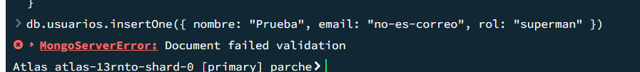

# Guía de sustentación y demostración — Parche

Qué explicar, qué abrir, qué escribir y qué debe salir. Une la guía de sustentación (explicaciones) y la guía de demostración (pasos en vivo).

## Antes de presentar

- Abrir https://parche-akv4.onrender.com/api/salud unos minutos antes: el plan gratuito de Render se duerme y la primera respuesta tarda cerca de un minuto. Debe salir `"estado": "ok"` con el conteo de documentos.
- Compartir solo https://parche-six.vercel.app: las direcciones de rama y de despliegue de Vercel piden iniciar sesión.
- Compass abierto con **Parche Atlas** conectado.
- VS Code abierto en `C:\Users\camil\Proyectos\Parche`.
- Para las demos locales: API en http://127.0.0.1:8000 y la interfaz en http://localhost:5173 (comandos en el README).
- Si cambió la red (otra IP), agregarla en Atlas → Network Access → *Add Current IP Address*.

---

# Parte 1. Recorrido de una reserva, de punta a punta

> Un jugador abre la Pista 3 del Pádel Club Chapinero, toca **mañana a las 9 p. m.** (hora pico) y luego **"Reservar y pagar $100.000"**.

| # | Capa | Qué pasa | Dónde mostrarlo |
|---|---|---|---|
| 1 | **Regleta** | Pinta cada hora según `GET /api/canchas/{id}/disponibilidad`: libre (tiza con el precio), pico (línea punteada y "Pico"), ocupada (rayado, deshabilitada) y elegida (naranja, "1 de 2"). Solo dibuja: no decide el precio ni la disponibilidad | `frontend/src/componentes/Regleta.jsx:17` |
| 2 | **Interfaz** | `reservar()` arma el cuerpo con `cancha_id`, `fecha`, `hora_inicio`, `horas`, `deporte`, `modalidad`, `metodo_pago` y `abierta`. **No envía el precio**: ese lo decide el servidor | `frontend/src/paginas/Detalle.jsx:110` |
| 3 | **Api.js** | `api()` hace `fetch POST /api/reservas` con `Authorization: Bearer <token>`. Corta la petición a los 45 s (`AbortController`); si responde 401 cierra la sesión y lleva a Ingresar; si no es 2xx convierte el `detail` en un mensaje | `frontend/src/servicios/Api.js:24`, `:33`, `:62` y `:66` |
| 4 | **Pydantic** | `ReservaEntrada` valida la forma: fecha `AAAA-MM-DD`, horas entre 1 y 3, método de pago válido. Si algo falla responde **422**, con el mensaje traducido al español | `backend/app/Modelos.py:104` · traducción en `backend/app/Errores.py:89` |
| 5 | **Autorización** | `Depends(solo_cliente)` ejecuta `usuario_actual` (verifica firma y expiración del JWT y trae al usuario activo) y `requiere_rol("cliente")`. Sin token **401**; con otro rol **403** | `backend/app/Seguridad.py:65` y `:85` |
| 6 | **Reglas** | Cancha activa de una sede aprobada y de un propietario activo; la cancha ofrece ese deporte y modalidad; la hora no es pasada, no supera 30 días y está dentro del horario de la sede, con la hora del **servidor** en Bogotá | `backend/app/routers/Reservas.py:36-62` y `:83-88` |
| 7 | **Precio** | `precio_total = sum(precio_de_hora(...))`: hora normal, o pico si empieza entre 6 y 9 p. m. Aquí: $100.000 | `Reservas.py:94` · `backend/app/Utilidades.py:15` y `:61` |
| 8 | **Base de datos** | `insert_one(reserva)` con `franjas: ["2026-11-11T21"]` y `estado: "activa"`. El índice **`ux_cancha_franja_activa`** (único y parcial sobre `cancha_id` + `franjas`, solo para `estado: "activa"`) **rechaza** el documento si otra reserva o bloqueo activo ya tiene esa franja | `Reservas.py:132` · índice en `backend/scripts/CrearColecciones.py:249` |
| 9 | **Respuesta** | **201** con la reserva. Si el índice la rechaza, la API atrapa el `DuplicateKeyError` y responde **409** "Ese horario ya está ocupado en esta cancha" | `Reservas.py:133-135` |
| 10 | **Interfaz** | Con 201 muestra la reserva confirmada. Con 409 muestra el mensaje y **vuelve a cargar la regleta**, porque alguien tomó la hora | `Detalle.jsx:133` |

🗣 *"El cruce no se revisa con un if: si dos personas reservan a la vez, ambas pasarían el if. El índice único parcial hace que la base acepte la primera y rechace la segunda."*

---

# Parte 2. Demostraciones en vivo

## Demo 1 — Las credenciales no están en el repositorio
**Dónde:** terminal de VS Code, en la raíz del proyecto.
```
git check-ignore -v backend/.env
```
**Debe salir:** `.gitignore:2:.env	backend/.env`
**Qué decir:** "El .env existe en mi PC, pero Git lo ignora por la regla de la línea 2; en GitHub solo está el .env.example. En Render las claves están en sus variables de entorno."

## Demo 2 — La base está en la nube
**Dónde:** Compass → Parche Atlas → base `parche`.
**Qué mostrar:** las 5 colecciones con datos; abrir `reservas` y filtrar:
```
{ "partido_abierto.estado": "completo" }
```
**Qué decir:** "Estos datos están en Atlas, AWS N. Virginia; aquí se ve un partido abierto con sus participantes embebidos."

## Demo 3 — La validación rechaza datos inválidos
**Dónde:** Compass → *Open MongoDB shell*.
```
use parche
```
```
db.usuarios.insertOne({ nombre: "Prueba", email: "no-es-correo", rol: "superman" })
```
**Debe salir:** `MongoServerError: Document failed validation` (abrir la flecha ▸ para ver el detalle).
**Qué decir:** "El propio servidor de MongoDB rechaza el documento por el $jsonSchema: faltan campos, el email no es válido y el rol no existe."



## Demo 4 — El índice que impide cruzar reservas
```
db.reservas.getIndexes()
```
**Qué señalar:** `ux_cancha_franja_activa` con `unique: true` y `partialFilterExpression: { estado: 'activa' }`.
**Qué decir:** "Este índice único parcial impide que dos reservas activas ocupen la misma franja de la misma cancha. Al cancelar o finalizar una reserva, sale del índice y la franja queda libre."

## Demo 5 — Login y roles
**Dónde:** http://127.0.0.1:8000/docs (o https://parche-akv4.onrender.com/docs).
1. Login como Laura → Authorize → `GET /api/propietario/sedes` → **200** con sus 2 sedes.
2. Login como un cliente → Authorize → mismo endpoint → **403**.

**Qué decir:** "El token dice quién soy y mi rol; la dependencia requiere_rol deja pasar solo a propietarios."

## Demo 6 — Reserva cruzada rechazada
1. `GET /api/canchas/{id}/disponibilidad?fecha=...` → elegir una hora **ocupada**.
2. Como cliente: `POST /api/reservas` en esa hora → **409 "Ese horario ya está ocupado en esta cancha"**.
3. En Compass, el conteo de `reservas` no cambió.

**Qué decir:** "No es un if: el índice único rechaza la inserción y el backend traduce el error a 409." Mostrar `Reservas.py:132-135`.

## Demo 7 — Sede pendiente no aparece hasta aprobarla
1. `GET /api/canchas?zona=Fontibón` → **total 0**.
2. Como admin: `GET /api/admin/sedes?estado=pendiente` → copiar el id → `POST /api/admin/sedes/{id}/aprobar`.
3. Repetir la búsqueda → **total 2**.

⚠️ Esto cambia datos en Atlas. Después de la demo, volver la sede a pendiente para poder repetirla.

## Demo 8 — Reservar desde la interfaz (con hora pico)
**Dónde:** https://parche-six.vercel.app (o http://localhost:5173).
1. Portada: tocar una hora de la noche → abrir una cancha → en la regleta elegir una hora con "Pico" → **Reservar y pagar**.
2. Mostrar la reserva confirmada y el precio de hora pico (lo calculó el servidor).
3. En Compass: `reservas` → filtro `{ "usuario.nombre": "<nombre del cliente>" }` → ver el documento nuevo con sus `franjas`.

**Qué decir:** "La interfaz llamó a la API con el token, la API aplicó las reglas y calculó el precio, y Atlas guardó el documento."

## Demo 9 — Regleta: estados sin color y teclado
En el detalle de una cancha:
- Señalar los cuatro estados: tiza con el precio (libre), línea punteada y "Pico", rayado con "Ocupada", naranja con ✓ (elegida).
- Elegir 3 horas en "Duración": las horas dicen "1 de 3", "2 de 3", "3 de 3" y el total suma hora pico y normal.
- Con teclado: Tab entra a la regleta, las flechas saltan las horas ocupadas, Enter elige.

**Qué decir:** "Cada estado se entiende sin color, y lo medimos con axe: 0 violaciones en modo claro y oscuro."

## Demo 10 — Planilla del propietario
Ingresar como Laura → **Mi panel → Agenda del día**: verde = reserva, naranja = partido abierto, rayado = bloqueo. Tocar una casilla libre y bloquearla.

## Demo 11 — Un reporte en vivo
**Dónde:** Compass → *Open MongoDB shell*. Copiar de `docs/Consultas.md` el bloque "Antes de empezar" y luego el reporte 7 (zonas).
**Debe salir:** Kennedy primero.
**Qué decir:** "Este pipeline agrupa todas las reservas por zona sin $lookup, porque cada reserva ya trae la zona copiada."

## Demo 12 — Dashboard del propietario y métricas
Ingresar como Laura → **Mi panel → Reportes**. Pasar el cursor por el mapa de calor y mostrar la hora más llena en naranja. Bajar a la tabla de canchas: la Cancha 3 de Suba con 0 h.
**Qué decir:** "Arranca desde canchas con un $lookup a reservas: por eso aparece la cancha en mantenimiento."
Luego como admin → **Administración → Métricas**.

## Demo 13 — Búsqueda, filtros y Atlas Search
**Dónde:** portada, sección "Todas las canchas".
1. Escribir `golaso` → salen las canchas de El Golazo y el aviso "Incluye resultados parecidos".
2. Tocar el chip **Pádel** y luego **Hoy** + "Libre a las 9 p. m.". Abrir **Más filtros** (precio, techo, zona, orden); se cierra con Esc o con un clic fuera. Mostrar el contador y **Limpiar todo**.
3. En `/docs`: `GET /api/canchas?texto=golaso` → `"motor_busqueda": "atlas_search"`; con `texto=gol` → `"regex"`.
4. En Atlas: *Search & Vector Search* → índice `busqueda_canchas` en estado READY.

**Qué decir:** "Cada filtro es un parámetro de GET /api/canchas. Atlas Search tolera errores y tildes; solo existe en Atlas. Si no encuentra nada, la API cae a $regex."

## Demo 14 — "Libre hoy" y "Cargar más"
1. En la lista, cada cancha muestra "Libre hoy: …" con las horas que le quedan.
2. En `/docs`: `GET /api/canchas/libres-hoy?ids=<id1>,<id2>` → por cada cancha, sus horas libres y el `motivo` si la sede está cerrada.
3. Bajar y tocar **Cargar más**: aparece "Se agregaron N canchas" y ninguna se repite.

**Qué decir:** "Es una sola consulta con $in para toda la página, y usa el mismo índice que evita los cruces: examina 5 de 964 documentos. La paginación desempata por _id para que no se repitan ni se pierdan canchas."

## Demo 15 — Errores claros
1. En `/docs`, autorizado como cliente, `POST /api/reservas` con `"horas": 9` → **422** con el mensaje en español y el campo que falló. Sin token responde antes **401**, porque primero se revisa quién eres.
2. Abrir https://parche-six.vercel.app/una-ruta-que-no-existe → página 404 "Balón por fuera".
3. Sin token, `POST /api/admin/mantenimiento/finalizar-reservas` → **401** "Debes iniciar sesión".

**Qué decir:** "Todos los errores llegan en JSON, en español y con CORS, así la interfaz muestra el motivo real. Si Atlas no responde, la API devuelve 503 en vez de colgarse."

## Demo 16 — Las pruebas automáticas
**Dónde:** terminal, en `backend`.
```
python -m pytest -q
```
**Debe salir:** 54 pruebas en verde.
**Qué decir:** "Corren contra un MongoDB real temporal, no contra Atlas, con los mismos índices y validadores. Si quito el desempate por _id, fallan 8 de las 9 pruebas de paginación."

---

# Parte 3. Lo nuevo de la evolución (para explicar)

**"Libre hoy" — `GET /api/canchas/libres-hoy?ids=`** (`backend/app/routers/Canchas.py:145`)
- Una sola consulta a `reservas` para toda la página: `cancha_id $in ids`, `franjas $in` las 24 franjas de hoy, `estado: "activa"`. Con `explain()` en Atlas usa `IXSCAN` sobre `ux_cancha_franja_activa` y examina 5 de 964 documentos.
- Máximo 50 ids (`MAXIMO_IDS_LIBRES`, línea 128) y validación de cada id (`_leer_ids`, línea 131). Usa la hora de Bogotá: no cuenta horas que ya pasaron y dice si la sede está cerrada hoy (`motivo`).
- Va antes de `/{cancha_id}` en el router; si no, FastAPI tomaría "libres-hoy" como un id.
- Si falla, la lista se muestra igual, sin la etiqueta (`frontend/src/paginas/Inicio.jsx:74`).

**Paginación estable** (`Canchas.py:118`): `("_id", 1)` como último criterio de `$sort`. Sin él, dos canchas con igual precio y nombre cambiaban de lugar entre páginas y "Cargar más" repetía una y perdía otra.

**Filtros** (`Inicio.jsx`, desde la línea 493): chips de deporte, modalidad, ciudad y "Cuándo"; panel "Más filtros" que se cierra con Esc o con clic fuera (línea 227) y devuelve el foco; contador y "Limpiar todo". La búsqueda por texto usa Atlas Search y, si no está disponible, `$regex` (`Canchas.py:26`).

**Regleta** (`Regleta.jsx`): estados entendibles sin color, operable con teclado. Si el enlace trae una hora ocupada (`?hora=19`), no se preselecciona (`Detalle.jsx:68`).

**Finalización de reservas** (`backend/app/CicloDeVida.py:20` y `:32`): las reservas activas cuya hora ya terminó pasan a `finalizada`. Es idempotente.
- Script `backend/scripts/FinalizarReservas.py`: por defecto solo muestra qué cambiaría; aplica con `--aplicar`.
- En Atlas se aplicó a 29 reservas, después de un respaldo de las 964, y los reportes dieron los mismos números antes y después.
- `POST /api/admin/mantenimiento/finalizar-reservas` existe solo para el administrador.
- Unirse, salir o cancelar una reserva `finalizada` o `cancelada` responde con un mensaje específico.

**Manejo de errores** (`backend/app/Errores.py`, registrado en `backend/app/Main.py:37-38`, antes de CORS):
- 422 de Pydantic traducido al español, con el campo que falló.
- Si Atlas no responde, **503** "La base de datos no está disponible en este momento…"; cualquier otro error, **500** "Ocurrió un error inesperado en el servidor…", siempre en JSON y con CORS.
- En la interfaz: tiempo máximo de 45 s, sesión vencida (401) → Ingresar con aviso, estados de error distintos del estado vacío y página 404.

**Moderación:** las canchas de propietarios desactivados no aparecen ni se pueden reservar (`Utilidades.py:56`). Rechazar una sede con reservas futuras pide confirmación (409 y luego `confirmar: true`, `backend/app/routers/Admin.py:65-73`).

## Las 54 pruebas automáticas (`backend/pruebas/`)

Corren con `pytest` contra un **MongoDB real temporal** (pymongo-inmemory), con las mismas colecciones, validadores e índices de Atlas, y con el reloj congelado en el 10 nov 2026, 10:00 a. m. en Bogotá. Nunca tocan Atlas: el `conftest.py` se niega a correr si la base no es la local `parche_pruebas`.

| Archivo | Pruebas | Qué cubre |
|---|---|---|
| `PruebaReservas.py` | 13 | Cruces parciales y simultáneos (409), reserva contra bloqueo, precio pico calculado por el servidor, pasado/30 días/horario, cancelación con 24 h, finalización idempotente, `$jsonSchema` rechazando un documento |
| `PruebaLibresHoy.py` | 15 | Conteo de horas libres, horas pasadas, sede cerrada, ids inválidos o demasiados, hora de Bogotá |
| `PruebaPaginacion.py` | 9 | Páginas sin repetidos ni perdidos con empates de precio y nombre |
| `PruebaSeguridad.py` | 9 | 401/403, token falso, nadie se registra como admin, correo repetido (409 por índice único), aislamiento entre propietarios, propietario desactivado, rechazo de sede con confirmación |
| `PruebaPartidos.py` | 7 | Cupo con uniones simultáneas, cuota, salir devuelve el cupo, partidos finalizados o cancelados |
| `PruebaReportes.py` | 1 | Reporte de deportes con desempate estable |

🗣 *"No usamos mongomock porque no aplica índices únicos sobre arreglos: con él, un cruce parcial de horas pasaba sin error. Por eso las pruebas usan un MongoDB real."*

Instalar antes: `pip install -r RequisitosPruebas.txt` (en `backend`).

## Cinco preguntas probables

**1. ¿Por qué embebieron el partido abierto en la reserva y no hicieron otra colección?**
Porque nace y muere con la reserva, se lee siempre junto con ella y su tamaño está acotado por los jugadores de la modalidad (máximo 16). Así, unirse al partido es **una sola actualización atómica** sobre un solo documento.

**2. ¿Cómo evitan que dos jugadores tomen el último cupo de un partido?**
Con `find_one_and_update` (`backend/app/routers/Partidos.py:90`). El filtro exige que el partido esté abierto, que el jugador no esté ya en él y, con `$expr`, que `size(participantes) < cupos - 1`. El `$push` solo ocurre si todo se cumple, en una única operación de MongoDB. En la prueba de concurrencia, de 6 intentos simultáneos con 3 cupos libres, entraron exactamente 3.

**3. ¿Por qué hay datos duplicados, como el nombre de la sede en la cancha y en la reserva?**
Son decisiones distintas:
- En `canchas`, la copia es una **referencia extendida** para buscar sin `$lookup`, y se sincroniza con `update_many` si la sede cambia de nombre.
- En `reservas`, la copia es **histórica**: el precio y los nombres del momento no deben cambiar.

**4. ¿Cómo aseguran que un propietario no vea los datos de otro?**
El `propietario_id` sale **del token**, nunca de la petición, y todas las consultas lo incluyen en el filtro. Si alguien pide una sede ajena, la API responde **404**, como si no existiera, para no revelar que existe.

**5. ¿Dónde están las credenciales y cómo se conecta la API a Atlas?**
En `backend/.env`, que Git ignora (`git check-ignore -v backend/.env`), y en las variables de entorno de Render. PyMongo usa un único `MongoClient` con TLS y el usuario `parche_app`, que solo tiene permisos sobre la base `parche`.

## Cambios en vivo que podrían pedir (y dónde hacerlos)

| Cambio | Archivo | Qué tocar |
|---|---|---|
| Cambiar la hora pico | `backend/app/Utilidades.py:15` | `HORA_PICO = range(18, 22)` (y `esPico` en `Regleta.jsx:15` para el dibujo) |
| Cancelar con 12 h en vez de 24 | `backend/app/routers/Reservas.py:28` | `HORAS_MINIMAS_CANCELAR` |
| Reservar con más anticipación | `Reservas.py:27` | `DIAS_MAXIMOS_ANTICIPACION` |
| Cambiar el top 10 de clientes a top 5 | `backend/app/routers/Reportes.py:123` | `{"$limit": 10}` de `mejores_clientes` (el de la línea 226 es el de zonas) |
| Unirse hasta 1 h antes | `backend/app/routers/Partidos.py:23` | `HORAS_LIMITE_UNIRSE` |
| Permitir más canchas en "Libre hoy" | `backend/app/routers/Canchas.py:128` | `MAXIMO_IDS_LIBRES` |
| Cambiar una condición de búsqueda | `Canchas.py` (función de `GET /api/canchas`) | El diccionario `filtro` que va a `find()`; por ejemplo `filtro["precio_hora"] = {"$lte": precio_max}` |

Después de un cambio en el backend, correr las pruebas: si alguna regla cambia a propósito, la prueba que la cubre debe fallar y ajustarse.
