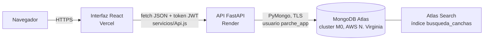
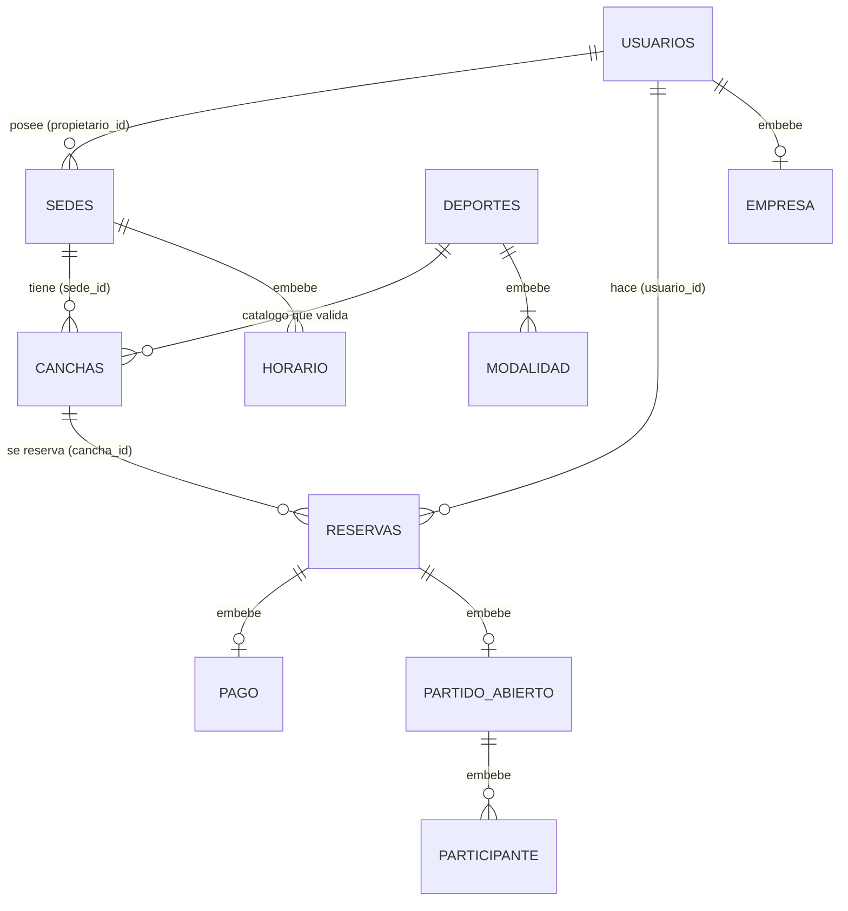

# Guion de sustentación — Parche

> Proyecto final de Bases de Datos II · Prof. Juan Carlos Gómez
> Integrantes: Juan Camilo Moreno, Marshall Robinson, Carlos Palacios
> App: https://parche-six.vercel.app · API: https://parche-akv4.onrender.com/docs · Repositorio: https://github.com/Juxn09/Parche

**Cómo usar este documento.** La **Parte A** es lo que se dice en voz alta, en orden, con las demos en su lugar. La **Parte B** es el anexo de consulta: cada herramienta con qué es, por qué, cómo se configuró y cómo mostrarla. Todo sale del código, los documentos y las pruebas del repositorio. Lo que se configuró en un panel web y no quedó en el código está marcado **CONFIGURADO EN PANEL: confirmar**.

---

# PARTE A — Guion para decir en voz alta

## 1. Apertura (~2 min)

**Ventana:** la app en https://parche-six.vercel.app (portada).

🗣 "Parche es un marketplace de reservas deportivas para Bogotá y Medellín. Resuelve un problema real: para jugar un partido hay que llamar a varias canchas, preguntar si hay hora, cuánto cuesta y, muchas veces, conseguir jugadores que falten."

🗣 "La web sirve a tres tipos de usuario:
- el **jugador** busca canchas por deporte, ciudad, precio y hora libre, reserva y paga (el pago es simulado), y puede abrir el partido para que otros se unan y paguen su parte;
- el **propietario** registra sus sedes y canchas, ve la agenda del día, bloquea horas y consulta reportes de su negocio;
- el **administrador** aprueba las sedes nuevas antes de que aparezcan en la búsqueda, desactiva usuarios y ve las métricas de toda la plataforma."

🗣 "Elegimos reservas deportivas porque el enunciado pedía un tema distinto al del Taller 3, que fue comercio electrónico, y porque tiene reglas de negocio interesantes para una base de datos: dos personas no pueden reservar la misma cancha a la misma hora, hay horas pico con otro precio y los partidos tienen cupos."

🗣 "Cumplimos la integración que pide el enunciado en tres capas: la **interfaz** en React, publicada en Vercel; la **API** en FastAPI, publicada en Render; y la **base de datos** en MongoDB Atlas, en la nube. La interfaz nunca habla con la base: siempre pasa por la API."

## 2. Arquitectura (~3 min)

**Ventanas:** diagrama (este documento o `docs/DocumentoTecnico.md`), luego `/api/salud`, luego Atlas web.



🗣 "El navegador carga la interfaz desde Vercel. Cada acción llama a la API con `fetch`, siempre desde un único archivo, `frontend/src/servicios/Api.js`, que agrega el token de sesión. La API valida, aplica las reglas y habla con Atlas usando PyMongo con un solo cliente. Atlas además tiene Atlas Search para la búsqueda por texto."

🗣 "Tenemos tres capas de defensa: la interfaz **orienta** (deshabilita horas ocupadas), la API **decide** (reglas y permisos) y la base **hace cumplir** lo crítico (validación `$jsonSchema` e índice único). Si alguien se salta la interfaz con Postman, la API y la base siguen protegiendo los datos."

**Demo A2.1 — la API está viva y conectada a Atlas.** Abrir https://parche-akv4.onrender.com/api/salud → `"estado": "ok"`, base `parche` y el conteo de cada colección. Mostrar `backend/app/Main.py:60` (ruta) y `:23` (si Atlas no responde, la API no arranca).

**Demo A2.2 — el cluster en la nube.** Atlas web → Clusters → `Parche`: M0 FREE, AWS N. Virginia (us-east-1), versión 8.0, réplica de 3 nodos, 1 índice de búsqueda.

## 3. Decisiones de modelado (~4 min)

**Ventanas:** diagrama del modelo, luego Compass.



*(Versión resumida para hablar; el diagrama completo con campos está en `docs/ModeloDeDatos.md` y en la página 4 del documento técnico.)*

🗣 "Usamos 5 colecciones: `usuarios`, `deportes`, `sedes`, `canchas` y `reservas`. La regla fue: **embebemos** lo que se lee junto y tiene tamaño acotado, y **referenciamos** lo que tiene vida propia o crece sin límite."

Ejemplos reales, uno por tipo de decisión:
- **Embebido — partido abierto en la reserva.** 🗣 "El partido nace y muere con la reserva y sus participantes están acotados por la modalidad, máximo 16. Unirse es una sola actualización atómica con `find_one_and_update`" (`backend/app/routers/Partidos.py:90`).
- **Referencia extendida — sede copiada en la cancha.** 🗣 "La cancha guarda `sede_id` y además una copia del nombre, ciudad y zona de la sede, para buscar sin `$lookup`. Si la sede cambia de nombre, la copia se sincroniza con `update_many`."
- **Copia histórica — precio y nombres en la reserva.** 🗣 "La reserva guarda el precio y los nombres del momento. Si mañana sube el precio, el historial no cambia."
- **Catálogo por nombre — deportes.** 🗣 "La cancha guarda el deporte y la modalidad como texto; al crearla, la API revisa que existan en el catálogo `deportes`" (`backend/app/routers/Propietario.py:57-66`).
- **Bloqueos dentro de `reservas`.** 🗣 "Un bloqueo del propietario es una reserva con `tipo: "bloqueo"`. Así el mismo índice impide reservar una hora bloqueada y bloquear una hora reservada."

🗣 "**Concurrencia:** cada reserva guarda sus horas como `franjas`, por ejemplo `2026-11-11T21`. El índice `ux_cancha_franja_activa` es **único** sobre `cancha_id` + `franjas` y **parcial**: solo cuenta las reservas `activa`. Si dos personas reservan la misma hora al mismo tiempo, la base acepta la primera y rechaza la segunda. Al cancelar, la reserva deja de ser activa y la hora se libera sola" (`backend/scripts/CrearColecciones.py:249`).

🗣 "**Validación:** cada colección tiene un `$jsonSchema` con `validationLevel: strict` y `validationAction: error` (`CrearColecciones.py:263-271`). Aunque alguien escriba directo en la base, sin pasar por la API, MongoDB rechaza el documento."

**Demo A3.1 — validación (no escribe nada).** Compass → *Open MongoDB shell*:
```
use parche
db.usuarios.insertOne({ nombre: "Prueba", email: "no-es-correo", rol: "superman" })
```
Debe salir `MongoServerError: Document failed validation`.

**Demo A3.2 — índices.** `db.reservas.getIndexes()` → señalar `ux_cancha_franja_activa` con `unique: true` y `partialFilterExpression: { estado: 'activa' }`.

## 4. Funcionalidades y recorrido de una reserva (~5 min)

**Ventana:** la app, con sesión de jugador.

**Demo A4.1 — buscar.** En "Todas las canchas", escribir `golaso` → aparecen las canchas de El Golazo y el aviso "Incluye resultados parecidos". Tocar el chip **Pádel**, luego **Hoy** y "Libre a las 9 p. m.". 🗣 "Cada filtro es un parámetro de `GET /api/canchas`. La búsqueda por texto usa Atlas Search, que tolera errores y tildes; si no encuentra nada, la API usa `$regex`" (`backend/app/routers/Canchas.py:26`).

**Demo A4.2 — reservar con hora pico (ESCRIBE EN ATLAS).** Abrir una cancha → elegir **pasado mañana o después** una hora con "Pico" → **Reservar y pagar**. 🗣 "La interfaz no envía el precio: lo calcula el servidor."

**El recorrido, de punta a punta:**

| # | Capa | Qué pasa | Dónde mostrarlo |
|---|---|---|---|
| 1 | Regleta | Pinta cada hora con `GET /api/canchas/{id}/disponibilidad`: libre, pico, ocupada, elegida | `frontend/src/componentes/Regleta.jsx:17` |
| 2 | Interfaz | `reservar()` arma el cuerpo con `cancha_id`, `fecha`, `hora_inicio`, `horas`, `deporte`, `modalidad`, `metodo_pago`, `abierta`. Sin precio | `frontend/src/paginas/Detalle.jsx:110` |
| 3 | Api.js | `fetch POST /api/reservas` con `Authorization: Bearer <token>`; corta a los 45 s; si responde 401 cierra la sesión | `frontend/src/servicios/Api.js:24`, `:33`, `:62` |
| 4 | Pydantic | `ReservaEntrada` valida la forma (horas entre 1 y 3, fecha, método de pago). Si falla: 422 en español | `backend/app/Modelos.py:104` · `backend/app/Errores.py:89` |
| 5 | Permisos | `solo_cliente` verifica el JWT y el rol. Sin token 401; otro rol 403 | `backend/app/Seguridad.py:65` y `:85` |
| 6 | Reglas | Cancha activa de sede aprobada y propietario activo; ofrece esa modalidad; ni pasado, ni más de 30 días, ni fuera del horario; hora de Bogotá | `backend/app/routers/Reservas.py:36-62` y `:83-88` |
| 7 | Precio | Suma hora por hora: normal o pico (franjas de 6 a 9 p. m.) | `Reservas.py:94` · `backend/app/Utilidades.py:15` y `:61` |
| 8 | Base | `insert_one` con `franjas` y `estado: "activa"`; el índice único rechaza un cruce | `Reservas.py:132` |
| 9 | Respuesta | 201 con la reserva; si hubo cruce, `DuplicateKeyError` → 409 | `Reservas.py:133-135` |
| 10 | Interfaz | Muestra la confirmación; con 409 recarga la regleta | `Detalle.jsx:133` |

**Demo A4.3 — el documento en Atlas.** Compass → `reservas` → filtro `{ "usuario.nombre": "<nombre del jugador>" }` → ver `franjas`, `precio_total`, `pago` y la copia de `cancha`.
*Revertir:* desde **Mis reservas → Cancelar** (la API exige 24 h de anticipación; por eso se reserva para pasado mañana). La reserva queda `cancelada`, no se borra, y la hora se libera.

**Demo A4.4 — cruce rechazado (no escribe nada).** En `/docs`, como jugador, `POST /api/reservas` en una hora que la regleta muestra "Ocupada" → **409 "Ese horario ya está ocupado en esta cancha"**. El conteo de reservas en Compass no cambia.

**Demo A4.5 — propietario (ESCRIBE EN ATLAS).** Ingresar como propietario → **Mi panel → Agenda del día**: verde reserva, naranja partido abierto, rayado bloqueo. Tocar una hora libre y bloquearla. *Revertir:* tocar el bloqueo y quitarlo.

**Demo A4.6 — administrador (ESCRIBE EN ATLAS, opcional).** `GET /api/canchas?zona=Fontibón` → total 0. Como admin, aprobar la sede pendiente "Arena Sport Fontibón" → repetir la búsqueda → aparecen sus canchas. *Revertir:* en Compass, en `sedes`, cambiar `estado` de esa sede a `"pendiente"` (sirve también como demo de "modificar un registro").

## 5. Consultas y reportes (~3 min)

🗣 "Los reportes se calculan dentro de la base con Aggregation Pipeline. Son 9: 5 para el propietario y 4 para el administrador. Usan los operadores que pide el enunciado: `$match`, `$group`, `$project`, `$sort`, `$limit`, `$lookup` y `$unwind`, además de `$cond` y `$facet`" (`backend/app/routers/Reportes.py`; textos de cada consulta en `docs/Consultas.md`).

| # | Reporte | Pregunta que responde | Operadores clave |
|---|---|---|---|
| 1 | Mapa de calor | ¿A qué hora y día se llenan mis canchas? | `$match → $unwind → $project → $group` |
| 2 | Ingresos por sede y mes | ¿Cuánto factura cada sede? | `$group` sin `$lookup` (usa la copia) |
| 3 | Top 10 clientes | ¿Quiénes reservan más? | `$group → $sort → $limit → $lookup` |
| 4 | Cancelaciones | ¿Qué cancha tiene más cancelaciones? | `$group` con `$cond` |
| 5 | Subutilizadas | ¿Qué cancha casi no se usa? | desde `canchas` con `$lookup` a reservas |
| 6 | Deportes (admin) | ¿Qué deporte y modalidad se reservan más? | `$group → $sort` (desempate por nombre) |
| 7 | Zonas (admin) | ¿Qué zonas tienen más demanda? | `$group` con la copia `cancha.zona` |
| 8 | Partidos (admin) | ¿Se llenan los partidos abiertos? | `$facet` |
| 9 | Mensual (admin) | ¿Cómo crece la plataforma? | `$group` por mes con `$cond` |

**Demo A5.1 — reporte en vivo.** Compass shell: pegar el bloque "Antes de empezar" de `docs/Consultas.md` y luego el reporte 7 → Kennedy primero. 🗣 "No necesita `$lookup` porque cada reserva ya trae la zona copiada."

**Demo A5.2 — dashboards.** App → **Mi panel → Reportes** (propietario): mapa de calor y la hora más llena; luego **Administración → Métricas**.

## 6. Calidad: pruebas y errores (~2 min)

🗣 "Tenemos 54 pruebas automáticas con pytest. Corren contra un MongoDB real temporal, con los mismos validadores e índices, nunca contra Atlas. No usamos mongomock porque no aplica índices únicos sobre arreglos: con él, un cruce parcial de horas pasaba sin error."

| Archivo | Pruebas | Qué cubre |
|---|---|---|
| `PruebaReservas.py` | 13 | Cruces parciales y simultáneos, bloqueos, precio pico del servidor, pasado/30 días/horario, cancelación con 24 h, finalización idempotente, `$jsonSchema` |
| `PruebaLibresHoy.py` | 15 | Horas libres de hoy, horas pasadas, sede cerrada, ids inválidos, hora de Bogotá |
| `PruebaPaginacion.py` | 9 | Páginas sin repetidos ni perdidos con empates |
| `PruebaSeguridad.py` | 9 | 401/403, token falso, sin registro como admin, correo repetido, aislamiento entre propietarios, propietario desactivado, rechazo de sede con confirmación |
| `PruebaPartidos.py` | 7 | Cupo con uniones simultáneas, cuota, salir, partidos finalizados o cancelados |
| `PruebaReportes.py` | 1 | Reporte de deportes con desempate estable |

**Demo A6.1 — correr las pruebas.** VS Code, terminal en `backend` (con el `.venv` activo): `python -m pytest` → debe terminar con "54 passed". Tarda unos minutos: la primera vez levanta un MongoDB temporal. (No agregar `-q`: `pytest.ini` ya lo trae y con dos se oculta el resumen.)

🗣 "Y los errores siempre llegan en JSON y en español: un dato mal enviado da 422 con el campo que falló; si Atlas no responde, 503; sin sesión, 401" (`backend/app/Errores.py`, registrado en `Main.py:37-38`).

## 7. Cierre (~1 min)

🗣 "En resumen: el modelo documental encaja con el negocio, la integridad crítica la garantiza la base de datos y no el código, los reportes responden preguntas reales del dueño y del administrador, y todo está en internet sin credenciales en el repositorio. Quedamos atentos a sus preguntas."

## 8. Qué le va a interesar al profesor (por criterio)

### Criterio 1 — Diseño de la solución y modelo de datos
| Pregunta probable | Qué quiere oír | Respuesta modelo |
|---|---|---|
| ¿Por qué embebieron el partido y no hicieron otra colección? | Que la decisión depende de cómo se lee y del tamaño | "Se lee siempre con la reserva y está acotado a 16 jugadores; así unirse es una sola operación atómica." |
| ¿Por qué hay datos repetidos? | Que cada copia tiene una regla | "La sede en la cancha se sincroniza; el precio en la reserva es histórico a propósito." |
| ¿Cómo evitan dos reservas a la misma hora? | Que lo hace la base, no un if | "Índice único parcial sobre cancha y franjas; la base rechaza la segunda inserción." |
| ¿Por qué MongoDB y no SQL? | Ajuste al caso, no moda | "Una reserva con su pago y su partido se lee en una consulta; Atlas además da Atlas Search y validación." |

### Criterio 2 — Desarrollo e integración
| Pregunta | Respuesta modelo |
|---|---|
| ¿Cómo se comunica la interfaz con la base? | "Nunca directo: Api.js llama a la API con el token; la API usa PyMongo con un solo cliente." |
| ¿Dónde están las validaciones? | "En tres capas: la interfaz orienta, Pydantic y las reglas en la API deciden, `$jsonSchema` e índices en la base." |
| ¿Cómo sabe la API quién soy? | "Un JWT firmado con HS256 que dice el id y el rol; en cada petición se consulta que el usuario siga activo." |
| ¿Qué pasa si se cae Atlas? | "La API responde 503 en JSON y la interfaz muestra el mensaje; al arrancar, si no hay conexión, la API no inicia." |

### Criterio 3 — Consultas y uso de la información
| Pregunta | Respuesta modelo |
|---|---|
| Explique un pipeline | Usar el reporte 1 o el 7 (tabla de la sección 5) y decir qué hace cada etapa. |
| ¿Para qué le sirve esto al dueño? | "Ver las horas pico para ajustar precios y las canchas subutilizadas para promocionarlas." |
| ¿La búsqueda es eficiente? | "`libres-hoy` hace una sola consulta con `$in` y usa el índice único: examina 5 de 964 documentos (explain en Atlas)." |

### Criterio 4 — Sustentación y dominio
| Pregunta | Respuesta modelo |
|---|---|
| Describa el recorrido de una operación | La tabla de 10 pasos de la sección 4. |
| ¿Dónde se guarda el precio de una reserva? | "En `reservas.precio_total` y en `reservas.pago.valor`, calculado en `Reservas.py:94`." |

### Cambios sencillos en vivo (los que menciona el enunciado)
| Pedido | Dónde | Qué hacer |
|---|---|---|
| Modificar un registro | Compass → colección → editar documento | Ej.: en `sedes`, cambiar `estado` de una sede; el `$jsonSchema` rechaza valores fuera de la lista |
| Cambiar una condición de búsqueda | `backend/app/routers/Canchas.py` (función de `GET /api/canchas`) | El diccionario `filtro` que va a `find()`; ej. `filtro["precio_hora"] = {"$lte": precio_max}` |
| Explicar una consulta | `backend/app/routers/Reportes.py` y `docs/Consultas.md` | Reporte 1 (línea 57) o 7 (línea 220) |
| Identificar dónde se almacena un dato | `docs/ModeloDeDatos.md` | Ej.: el horario de una sede está embebido en `sedes.horario` |
| Describir el recorrido de una operación | Tabla de la sección 4 | De `Detalle.jsx:110` a `Reservas.py:132` |
| Cambiar la hora pico | `backend/app/Utilidades.py:15` | `HORA_PICO = range(18, 22)` (y `esPico` en `Regleta.jsx:15`) |
| Cancelar con 12 h en vez de 24 | `backend/app/routers/Reservas.py:28` | `HORAS_MINIMAS_CANCELAR` |
| Top 5 en vez de top 10 | `backend/app/routers/Reportes.py:123` | `{"$limit": 10}` de `mejores_clientes` |

Después de cambiar el backend: correr las pruebas; si la regla cambió a propósito, la prueba que la cubre debe fallar y ajustarse.

## 9. Mapa contra el enunciado

| Requisito del enunciado | Dónde se cumple | Demo que lo prueba | Estado |
|---|---|---|---|
| Base de datos en la nube | MongoDB Atlas M0, AWS N. Virginia | A2.2, A3 | ✅ Verificado |
| Backend/API que procesa, valida y opera | FastAPI en `backend/app`, 41 rutas | A4.2, A4.4 | ✅ |
| Credenciales fuera del repositorio | `.gitignore`, `.env.example`, variables en Render | B, ficha f | ✅ (`git check-ignore`) |
| Desplegada y accesible desde internet | Vercel + Render | A2.1, apertura | ✅ 200 sin sesión en `parche-six` |
| Interfaz gráfica | React en `frontend/src` | Toda la Parte A | ✅ |
| Creación, consulta, actualización, eliminación | Sedes y canchas (`/api/propietario/*` con POST, GET, PUT, DELETE); reservas, bloqueos, usuarios | A4.2, A4.5 | ✅ |
| Búsqueda y filtrado | `GET /api/canchas` + Atlas Search | A4.1 | ✅ |
| Relaciones con información comprensible | Referencias extendidas y `$lookup` | A4.3, A5 | ✅ |
| Validaciones y reglas de negocio | Pydantic, `Reservas.py`, `$jsonSchema`, índices | A3.1, A4.4 | ✅ |
| Embedding y referencing justificados | `docs/ModeloDeDatos.md`, sección 3 | A3 | ✅ |
| Consultas con valor (Aggregation) | 9 reportes en `Reportes.py` | A5 | ✅ |
| Documentación de 14 puntos + enlaces | `docs/DocumentoTecnico.md` y su PDF | — | 🟡 Faltan las capturas E4 y E6, y los aprendizajes |
| Tema distinto al Taller 3 | Reservas deportivas | Apertura | ✅ |
| Trabajo en parejas | Somos tres | — | ⚠️ Confirmar con el profesor |
| **Criterio:** diseño y modelo | Sección 3 | A3 | ✅ |
| **Criterio:** desarrollo e integración | Secciones 2 y 4 | A4 | ✅ (login y reserva en producción: los prueba el usuario) |
| **Criterio:** consultas | Sección 5 | A5 | ✅ |
| **Criterio:** sustentación | Todo el guion | — | Depende del ensayo |

## 10. Reparto entre integrantes

El enunciado pide que **cada integrante domine el proyecto completo**, aunque se repartan los bloques. Este reparto es solo una propuesta para llenar:

| Bloque | Tiempo | Expone | Respaldo (si pregunta el profesor) |
|---|---|---|---|
| 1. Apertura | 2 min | ______ | ______ |
| 2. Arquitectura | 3 min | ______ | ______ |
| 3. Modelado | 4 min | ______ | ______ |
| 4. Funcionalidades y recorrido | 5 min | ______ | ______ |
| 5. Consultas y reportes | 3 min | ______ | ______ |
| 6. Calidad | 2 min | ______ | ______ |
| 7. Cierre | 1 min | ______ | ______ |
| Preguntas y cambios en vivo | 5–10 min | Todos | — |

Ensayo sugerido: que cada uno haga al menos una vez la demo de otro bloque.

## 11. Plan B

| Si pasa esto | Qué hacer |
|---|---|
| **Render dormido** (la primera respuesta tarda ~1 min) | Abrir `/api/salud` 5 minutos antes y dejar la pestaña abierta. Si tarda en vivo, decir: "es el plan gratuito, se despierta en un minuto" y seguir con el diagrama |
| **Atlas no conecta desde la red del salón** | Antecedente: en otra red la API mostró `SSL handshake failed ... tlsv1 alert internal error` porque la IP no estaba en Network Access. Hoy Network Access tiene `0.0.0.0/0`, así que la app publicada (Render → Atlas) no depende de la red del salón. Lo que sí depende es **Compass y la API local** desde el portátil: si fallan, usar el hotspot del celular, o mostrar los datos desde la app publicada y las capturas |
| **Vercel no carga** | Correr la interfaz local (`npm run dev` en `frontend`, http://localhost:5173) apuntando a Render, o mostrar las capturas E8, E9 y E11 |
| **Se cae el Wi-Fi** | Hotspot del celular. Si no hay internet: mostrar el PDF del documento técnico (capturas de cada pantalla) y correr las 54 pruebas, que no necesitan internet |
| **Una demo que escribe en Atlas falla a mitad** | Revisar en Compass el estado del documento y revertir como dice cada demo |

Tener abiertas, por si acaso, las capturas de `Evidencias/Documento/` de la bóveda.

## 12. Orden de ventanas y tiempos

**Antes de empezar (10 minutos antes), en este orden:**
1. Navegador, pestaña 1: https://parche-akv4.onrender.com/api/salud (despierta Render; esperar `"estado": "ok"`).
2. Pestaña 2: https://parche-six.vercel.app con sesión de **jugador**.
3. Pestaña 3 (ventana privada): la app con sesión de **propietario**; luego de **admin** si se hace la demo A4.6.
4. Pestaña 4: https://parche-akv4.onrender.com/docs.
5. Pestaña 5: Atlas web en Clusters.
6. Compass conectado a **Parche Atlas**, con el shell abierto en `use parche`.
7. VS Code en el repositorio, con `Reservas.py`, `CrearColecciones.py` y `Reportes.py` abiertos, y una terminal en `backend`.
8. Este guion y el PDF del documento técnico.

**Línea de tiempo (~20 min + preguntas):**

| Minuto | Bloque | Ventana principal |
|---|---|---|
| 0–2 | Apertura | App (portada) |
| 2–5 | Arquitectura | Diagrama → `/api/salud` → Atlas |
| 5–9 | Modelado | Diagrama → Compass |
| 9–14 | Funcionalidades y recorrido | App → Compass → `/docs` → VS Code |
| 14–17 | Consultas y reportes | Compass → App (paneles) |
| 17–19 | Calidad | VS Code (terminal) |
| 19–20 | Cierre | App |
| 20+ | Preguntas y cambios en vivo | Según la pregunta |

---

# PARTE B — Anexo técnico de consulta

## B1. Inventario de herramientas

Versiones tomadas de `backend/requirements.txt`, `backend/RequisitosPruebas.txt`, `frontend/package.json` y de lo instalado en el equipo de desarrollo.

### a) MongoDB Atlas
- **Qué es:** el servicio de MongoDB en la nube, administrado por MongoDB.
- **Qué hace en Parche:** guarda las 5 colecciones de la base `parche` (`usuarios`, `deportes`, `sedes`, `canchas`, `reservas`) y el índice de búsqueda `busqueda_canchas`.
- **Por qué:** el enunciado pide una base en la nube; Atlas da validación `$jsonSchema`, índices parciales y Atlas Search, que solo existe en Atlas. Se descartó una base local porque no cumple el requisito de nube.
- **Cómo se configuró:**
  1. Cluster **M0 (gratis)** llamado `Parche`, en **AWS N. Virginia (us-east-1)**; versión 8.0 y réplica de 3 nodos (visto en el panel de Atlas).
  2. Usuario de base de datos **`parche_app`** con `readWrite` y `dbAdmin` **solo sobre la base `parche`** (mínimo privilegio). El usuario creado por defecto, con rol Atlas Admin, se eliminó.
  3. **Network Access:** primero solo la IP del equipo de desarrollo (`/32`); luego `0.0.0.0/0`, porque Render no tiene IP fija. Se compensa con el usuario de mínimo privilegio, la contraseña fuera del código y TLS.
  4. La **cadena de conexión** (`mongodb+srv://…`) vive solo en la variable `MONGODB_URI`: en `backend/.env` (ignorado por Git) y en el panel de Render.
  5. Colecciones, validadores e índices: `python scripts/CrearColecciones.py` (ver ficha o).
  6. Índice de Atlas Search: `python scripts/CrearIndiceBusqueda.py` (ver ficha o).
  - **CONFIGURADO EN PANEL: confirmar** — fecha de creación del cluster, si hay alertas configuradas, y que Network Access tenga hoy `0.0.0.0/0`: ______
- **Índices:** ver la sección 5.3 del documento técnico. Los clave: `ux_cancha_franja_activa` (único, parcial), `ux_email` (único), `ux_nombre` (único), `ix_ubicacion_geo` (2dsphere).
- **Atlas Search:** índice `busqueda_canchas` sobre `canchas`, con el analizador propio `espanol_sin_tildes` (tokenizador `standard`, filtros `lowercase` e `icuFolding`), `dynamic: false` y solo los campos `nombre`, `sede.nombre`, `sede.zona`, `sede.ciudad`, `deportes.deporte` y `deportes.modalidad` (`backend/scripts/CrearIndiceBusqueda.py:30-60`).
- **Se conecta con:** la API (PyMongo) y, para administrar, Compass.
- **Si falla:** la API responde 503 y no arranca si no hay conexión. Se comprueba con `/api/salud`.
- **Cómo mostrarlo:** Atlas web → Clusters → `Parche`; Browse Collections; Search & Vector Search.

### b) Python y entorno virtual
- **Qué es:** el lenguaje del backend; `.venv` es una carpeta con las librerías del proyecto aisladas del sistema.
- **Qué hace:** ejecuta la API y los scripts.
- **Versiones:** en local, Python 3.14 dentro de `backend/.venv`; en Render, **Python 3.13**, fijado con el archivo `backend/.python-version`.
- **Cómo se configuró:** `python -m venv .venv` → activar → `pip install -r requirements.txt`. `requirements.txt` fija cada versión exacta (por ejemplo `fastapi==0.162.2`, `pymongo==4.19.0`), para que Render instale lo mismo que en local.
- **Si falla:** `pip install` falla en el build de Render y el despliegue no sale; se ve en los logs del panel.
- **Cómo mostrarlo:** VS Code → `backend/requirements.txt` y `backend/.python-version`.

### c) FastAPI + Uvicorn (y Starlette)
- **Qué es:** FastAPI es el framework web de la API (construido sobre Starlette); Uvicorn es el servidor que la ejecuta.
- **Qué hace:** `backend/app/Main.py` crea la app, registra el manejo de errores (`:37-38`), CORS (`:42-48`) y 7 routers (`:51-57`): `Auth`, `Canchas`, `Propietario`, `Reservas`, `Partidos`, `Admin` y `Reportes`, más `/api/salud` y `/api/deportes`. En total, 41 rutas.
- **Por qué:** valida los datos con Pydantic automáticamente y genera la documentación interactiva `/docs` sin trabajo extra. (No quedó registrada una alternativa evaluada: ______)
- **Versiones:** `fastapi==0.162.2`, `uvicorn==0.54.0`, `starlette==1.10.0`.
- **Cómo se configuró:** en local `uvicorn app.Main:app --reload` (puerto 8000); en Render `uvicorn app.Main:app --host 0.0.0.0 --port $PORT`.
- **CORS:** solo acepta las direcciones de la variable `FRONTEND_URL` (varias, separadas por coma, `backend/app/Config.py:29`).
- **Errores:** `backend/app/Errores.py` traduce los 422 al español y convierte las caídas de Atlas en 503 y lo inesperado en 500, siempre en JSON y con CORS.
- **Cómo mostrarlo:** https://parche-akv4.onrender.com/docs.

### d) PyMongo
- **Qué es:** el driver oficial de MongoDB para Python.
- **Qué hace:** un **único `MongoClient`** para toda la API (`backend/app/BaseDatos.py:15-21`), con `serverSelectionTimeoutMS=8000` (si Atlas no responde en 8 s, error claro), `tz_aware=True` (fechas con zona horaria) y `appname="Parche API"`. PyMongo mantiene un pool de conexiones y las reutiliza.
- **TLS:** la cadena `mongodb+srv` de Atlas usa TLS por defecto; el código no lo configura aparte.
- **Versión:** `pymongo==4.19.0` (con `dnspython` para resolver `mongodb+srv`).
- **Si falla:** `ServerSelectionTimeoutError` → 503 (`Errores.py`).

### e) Pydantic, PyJWT y bcrypt
- **Pydantic** (`pydantic==2.14.3`): define la forma de cada entrada; por ejemplo `ReservaEntrada` (`backend/app/Modelos.py:104`) exige horas entre 1 y 3. Si algo no cumple, 422 antes de ejecutar la ruta.
- **PyJWT** (`PyJWT==2.15.1`): crea y verifica el token de sesión, firmado con HS256 y la clave `JWT_SECRET`. Dura `JWT_MINUTOS` (por defecto 480 min = 8 h) (`backend/app/Seguridad.py:17` y `:37-51`).
- **bcrypt** (`bcrypt==5.0.0`): guarda las contraseñas como hash con sal; no se pueden revertir (`Seguridad.py:24-31`).
- **Cómo se conectan:** `usuario_actual` (`Seguridad.py:65`) lee el token, verifica firma y expiración y consulta que el usuario siga activo; `requiere_rol` (`:85`) deja pasar solo ciertos roles.

### f) python-dotenv, `.env`, `.env.example`, `.gitignore`
- **Qué es:** python-dotenv (`1.2.4`) lee variables desde un archivo `.env`.
- **Qué hace:** `backend/app/Config.py:12` carga `backend/.env`; `MONGODB_URI` y `JWT_SECRET` son obligatorias (`:15-25`): sin ellas la API no arranca.
- **Variables del backend (solo nombres):** `MONGODB_URI`, `MONGODB_DB`, `JWT_SECRET`, `FRONTEND_URL`, `SEED_PASSWORD` (solo para `CargarDatos.py`) y, opcional, `JWT_MINUTOS`.
- **Variable del frontend:** `VITE_API_URL` (no es secreta: el navegador la ve).
- **Protección:** `.gitignore` excluye `.env` y `.env.*` pero permite `.env.example`, que es la plantilla sin valores. En Render y Vercel las variables se ponen en el panel.
- **Cómo comprobarlo:** `git check-ignore -v backend/.env` → `.gitignore:2:.env`.

### g) React, Vite, react-router, Tailwind 4, lucide-react
- **Qué es:** React (`19.3.1`) arma la interfaz con componentes; Vite (`8.3.6`) la sirve en desarrollo y la compila; react-router (`8.5.1`) maneja las rutas; Tailwind CSS 4 (`4.3.5`, plugin `@tailwindcss/vite`) da los estilos; lucide-react (`1.70.0`) da los íconos. La tipografía Archivo se carga desde Google Fonts (`frontend/index.html`).
- **Estructura:** `frontend/src/paginas` (una por pantalla: Inicio, Detalle, MisReservas, Partidos, PanelPropietario, PanelAdmin, Ingresar, Registro, NoEncontrada), `componentes` (Piezas, Regleta, Encabezado, Gráficas…), `contexto/Sesion.jsx` (sesión) y `servicios` (`Api.js`, `Catalogo.js`).
- **Api.js, único cliente HTTP:** todas las llamadas pasan por `api()` (`frontend/src/servicios/Api.js:24`): agrega el token, corta a los 45 s (`:8`, `:33`), avisa a la sesión si llega un 401 (`:62`) y convierte el `detail` de la API en un mensaje (`:66`).
- **Sistema de diseño:** colores y medidas como variables CSS en `frontend/src/Estilos.css` (con modo claro y oscuro) y piezas reutilizables en `frontend/src/componentes/Piezas.jsx` (botones, chips, pestañas, avisos, diálogos).
- **Configuración:** `frontend/vite.config.js` (plugins React y Tailwind, puerto 5173 fijo); `npm install`, `npm run dev`, `npm run build`.

### h) Render
- **Qué es:** servicio en la nube que ejecuta la API.
- **Cómo se configuró (según el README):** Web Service desde el repositorio, rama `main`, Root Directory `backend`, Build `pip install -r requirements.txt`, Start `uvicorn app.Main:app --host 0.0.0.0 --port $PORT`, Health check `/api/salud`, Python 3.13 por `backend/.python-version`. Variables (nombres): `MONGODB_URI`, `MONGODB_DB`, `JWT_SECRET`, `FRONTEND_URL`.
- **FRONTEND_URL y CORS:** contiene la dirección de Vercel y la local, separadas por coma. Verificado: la API acepta `https://parche-six.vercel.app` y no da permiso a un origen ajeno.
- **Despliegue automático:** cada push a `main` redespliega (comprobado el 10 nov 2026: listo en ~1 minuto).
- **El sueño del plan gratuito:** tras unos 15 minutos sin uso se suspende y la primera petición tarda cerca de un minuto.
- **CONFIGURADO EN PANEL: confirmar** — plan (Free), región del servicio y si el auto-deploy está activo: ______

### i) Vercel
- **Qué es:** servicio que publica la interfaz.
- **Cómo se configuró:** proyecto `parche` del equipo `juxn-s-projects`, desde el repositorio, Root Directory `frontend`, preset **Vite**, variable `VITE_API_URL` con la URL de Render. `frontend/vercel.json` reescribe todas las rutas a `index.html`, para que funcionen al recargar `/canchas/…`.
- **Dominio de producción:** `parche-six.vercel.app` (rama `main`). Responde 200 sin sesión.
- **Protección de despliegues:** las direcciones de rama (`parche-git-…-juxn-s-projects.vercel.app`) y de despliegue puntual piden iniciar sesión en Vercel (302 a `vercel.com/sso-api`); por eso solo se comparte `parche-six`.
- **CONFIGURADO EN PANEL: confirmar** — comando de build y carpeta de salida (por defecto del preset: `npm run build` y `dist`), versión de Node y modo exacto de Deployment Protection: ______

### j) Git y GitHub
- **Repositorio:** https://github.com/Juxn09/Parche.
- **Ramas:** `main` (la que se despliega) y `evolucion` (mejoras de la última fase; se fusionó en `main` el 10 nov 2026).
- **Tags de respaldo:** `respaldo-pre-evolucion` y `respaldo-main-9ba9116`, ambos en el `main` anterior a la fusión, para volver atrás si hiciera falta.
- **Flujo:** cambios pequeños con un commit cada uno; antes de fusionar, 54 pruebas y `vite build` sin errores; push a `main` → Render y Vercel redespliegan.

### k) VS Code y Claude Code
- **VS Code:** editor y terminal para correr la API, la interfaz, los scripts y las pruebas.
- **Claude Code** (asistente de programación con IA de Anthropic): se usó durante todo el desarrollo para escribir buena parte del código, los scripts, las pruebas y la documentación, por fases y siguiendo nuestras instrucciones. Nosotros definimos el tema, las reglas y las decisiones, aprobamos cada cambio a la base de datos antes de ejecutarlo y revisamos y probamos el resultado.
- **Confirmar con el equipo** cómo describir la proporción del trabajo de cada uno: ______
- Notas de estudio y decisiones del proyecto: bóveda de Obsidian.

### l) pytest y pymongo-inmemory
- **Qué es:** pytest (`9.2.0`) corre las pruebas; pymongo-inmemory (`0.5.0`) levanta un MongoDB real temporal (versión 7.0) solo para las pruebas; httpx (`0.28.1`) lo usa el cliente de pruebas de FastAPI.
- **Por qué no mongomock:** no aplica índices únicos sobre arreglos; con él, un cruce parcial de horas pasaba sin error.
- **Seguridad:** `backend/pruebas/conftest.py` se niega a correr si la base no es la local `parche_pruebas`; nunca toca Atlas. El reloj está congelado en el 10 nov 2026, 10:00 a. m. (Bogotá).
- **Instalación:** `pip install -r RequisitosPruebas.txt` (no se instala en Render). Configuración en `backend/pytest.ini` (archivos `Prueba*.py`, funciones `prueba_*`).
- **Cómo mostrarlo:** `python -m pytest` → "54 passed".

### m) ESLint, axe y Lighthouse
- **ESLint** (`9.39.5`, con reglas de React Hooks): revisa el código de la interfaz; `npm run lint` → 0 errores.
- **axe-core** (`4.10.2`, dependencia de desarrollo): midió contraste y accesibilidad de la regleta y la portada, en modo claro y oscuro: 0 violaciones.
- **Lighthouse:** no se usó.

### n) Compass y mongosh
- **Compass:** la aplicación de escritorio de MongoDB, conectada a Atlas como "Parche Atlas"; se usó para revisar documentos, colecciones e índices.
- **mongosh:** la consola de MongoDB, dentro de Compass (*Open MongoDB shell*); se usó para probar la validación (`insertOne` inválido), ver índices (`getIndexes`) y correr los pipelines de `docs/Consultas.md`.

### o) Scripts (`backend/scripts/`)
| Script | Qué hace | ¿Destructivo? |
|---|---|---|
| `CrearColecciones.py` | Crea o actualiza las 5 colecciones con su `$jsonSchema` (`strict` + `error`) y todos los índices. Se puede repetir | No borra datos |
| `CrearIndiceBusqueda.py` | Crea o actualiza el índice de Atlas Search `busqueda_canchas` y espera a que quede listo | No borra datos |
| `CargarDatos.py` | Llena la base con datos de prueba realistas | **SÍ: borra todos los documentos** de las 5 colecciones antes de cargar (pide escribir SI). No se debe correr contra Atlas sin un respaldo |
| `FinalizarReservas.py` | Pasa a `finalizada` las reservas y bloqueos activos que ya terminaron. Por defecto solo cuenta; aplica con `--aplicar` | No borra; cambia el estado. Idempotente |

## B2. Cómo se despliega de cero

1. **Atlas:** crear el cluster M0 en AWS N. Virginia → crear el usuario `parche_app` con permisos solo sobre `parche` → Network Access `0.0.0.0/0` → copiar la cadena de conexión.
2. **Base:** en local, crear `backend/.env` desde `.env.example` con `MONGODB_URI`, `MONGODB_DB` y `JWT_SECRET` → `python scripts/CrearColecciones.py` → `python scripts/CrearIndiceBusqueda.py` → (opcional, base vacía) `python scripts/CargarDatos.py`.
3. **API en Render:** nuevo Web Service desde GitHub, rama `main`, Root `backend`, Build `pip install -r requirements.txt`, Start `uvicorn app.Main:app --host 0.0.0.0 --port $PORT`, Health check `/api/salud`, variables `MONGODB_URI`, `MONGODB_DB`, `JWT_SECRET` y `FRONTEND_URL` (provisional) → comprobar `/api/salud`.
4. **Interfaz en Vercel:** nuevo proyecto desde GitHub, Root `frontend`, preset Vite, variable `VITE_API_URL` = URL de Render → desplegar → anotar el dominio de producción.
5. **CORS:** en Render, poner en `FRONTEND_URL` el dominio de Vercel y `http://localhost:5173`, separados por coma → guardar (Render reinicia) → abrir la app y comprobar que carga las canchas.

## B3. Preguntas de configuración

| Pregunta | Respuesta corta |
|---|---|
| ¿Dónde están las credenciales? | En `backend/.env` (ignorado por Git) y en las variables de entorno de Render. En el repositorio solo está `.env.example` sin valores. |
| ¿Cómo se conecta la API a Atlas? | PyMongo con un único `MongoClient` y la cadena de `MONGODB_URI`, con el usuario `parche_app` (solo base `parche`) y TLS. `BaseDatos.py:15`. |
| ¿Qué pasa si cambia la URL de Vercel? | El navegador bloquea las llamadas por CORS hasta poner la nueva URL en `FRONTEND_URL` de Render. También hay que actualizar los enlaces del documento. |
| ¿Qué pasa si cambia la URL de Render? | Cambiar `VITE_API_URL` en Vercel y volver a desplegar la interfaz (la variable se incrusta al compilar). |
| ¿Cómo se despliega un cambio? | Commit y push a `main`: Render y Vercel redespliegan solos en uno o dos minutos. |
| ¿Por qué `0.0.0.0/0` en Atlas? | Render no tiene IP fija. Se compensa con mínimo privilegio, contraseña fuera del código y TLS. |
| ¿Por qué tarda la primera vez? | El plan gratuito de Render se duerme tras unos 15 minutos sin uso. |
| ¿Por qué otros ven un login de Vercel? | Abrieron una dirección de rama o de despliegue, que están protegidas; la pública es `parche-six.vercel.app`. |
| ¿Cómo se crean colecciones e índices? | Con scripts reproducibles: `CrearColecciones.py` y `CrearIndiceBusqueda.py`. |
