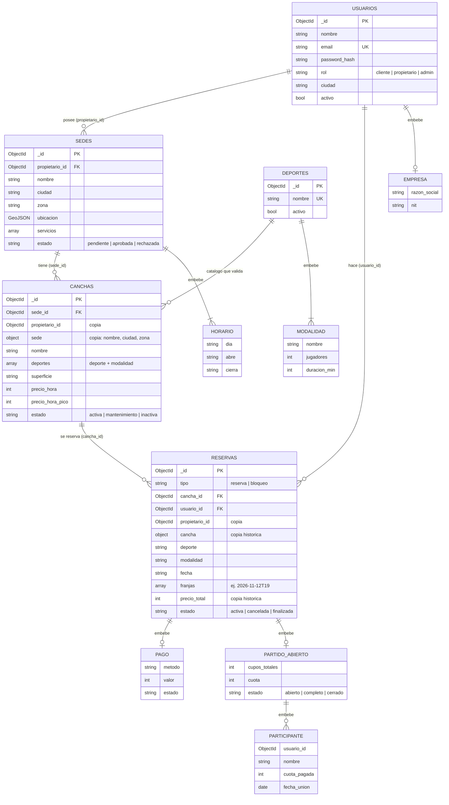

# Modelo de datos — Parche

Base de datos: **MongoDB Atlas**, base `parche`.
Modelo orientado a documentos: se embebe lo que se lee junto y tiene tamaño acotado; se referencia lo que tiene vida propia, crece sin límite o se consulta por separado.

## Diagrama

## Colecciones

| Colección | Qué guarda |
|---|---|
| `usuarios` | Clientes, propietarios y admins (una sola colección con campo `rol`: patrón polimórfico) |
| `deportes` | Catálogo de deportes y sus modalidades; alimenta los filtros y los cupos |
| `sedes` | Lugares físicos de cada propietario |
| `canchas` | Cada cancha, multiuso, con precios y estado |
| `reservas` | Reservas de clientes y bloqueos del propietario |

## Embedding vs Referencing

| Relación | Decisión | Por qué |
|---|---|---|
| Usuario → empresa | Embebido | 1:1, se lee siempre con el propietario |
| Deporte → modalidades | Embebido | Pocas, sin vida propia |
| Sede → horario y servicios | Embebido | Acotados, se leen con la sede |
| Sede → propietario | Referencia | Ambos existen por separado; `propietario_id` aísla los datos de cada dueño (multi-tenant) |
| Cancha → sede | Referencia + copia | La cancha es lo que se busca y se reserva; se copia nombre y zona de la sede para buscar sin `$lookup` (referencia extendida) |
| Reserva → cliente y cancha | Referencia + copia histórica | Las reservas crecen sin límite (máximo 16 MB por documento) y se consultan por separado; el precio y los nombres se copian como registro histórico |
| Reserva → pago y partido abierto | Embebido | Nacen y mueren con la reserva |
| Partido abierto → participantes | Embebido | Acotado por los jugadores de la modalidad |

**Copias que se sincronizan:** `sede.nombre` en canchas se actualiza con `update_many` si cambia la sede.
**Copias históricas:** `precio_total` y nombres en reservas nunca se actualizan.

## Índices

| Colección | Índice | Para qué |
|---|---|---|
| `usuarios` | `email` único | No repetir cuentas |
| `reservas` | `cancha_id + franjas` único parcial (`estado: "activa"`) | Ninguna reserva ni bloqueo se cruza en la misma cancha |
| `canchas` | Atlas Search | Búsqueda de texto tolerante a errores |
| `sedes` | `ubicacion` 2dsphere | Búsqueda por cercanía (extra) |

## Reglas de negocio y dónde se garantizan

| Regla | Capa |
|---|---|
| No cruzar reservas ni bloqueos | Base de datos (índice único parcial) |
| Email único | Base de datos (índice único) |
| Tipos y campos obligatorios | Base de datos (`$jsonSchema`) |
| Cancelar con mínimo 24 h (hora del servidor) | Backend |
| No reservar en el pasado, fuera de horario ni en mantenimiento | Backend |
| Precio de hora pico (18:00 a 22:00) | Backend |
| Cada propietario solo ve y edita lo suyo | Backend (`propietario_id` de la sesión) |
| Solo sedes aprobadas en búsquedas | Backend |
| Modalidad válida para el deporte | Backend (catálogo) |
| Partido abierto: sin superar cupos ni repetir jugador | Backend + actualización atómica |
| Unirse hasta 2 h antes | Backend |

## Reportes

| # | Pregunta | Rol | Operadores |
|---|---|---|---|
| 1 | ¿Qué días y horas se llenan? (mapa de calor) | Propietario | `$match`, `$unwind`, `$project`, `$group` |
| 2 | ¿Cuánto factura cada sede por mes? | Propietario | `$match`, `$group`, `$sort` |
| 3 | ¿Quiénes son los 10 mejores clientes? | Propietario | `$group`, `$sort`, `$limit`, `$lookup` |
| 4 | ¿Qué cancha tiene más cancelaciones? | Propietario | `$group`, `$cond`, `$project` |
| 5 | ¿Qué canchas casi no se usan? | Propietario | `$lookup`, `$project`, `$sort` |
| 6 | ¿Qué deportes y modalidades se reservan más? | Admin | `$group`, `$sort` |
| 7 | ¿Qué zonas tienen más demanda? | Admin | `$group`, `$sort`, `$limit` |
| 8 | ¿Los partidos abiertos se llenan? | Admin | `$match`, `$project`, `$size`, `$group` |