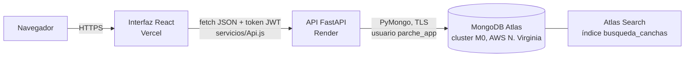
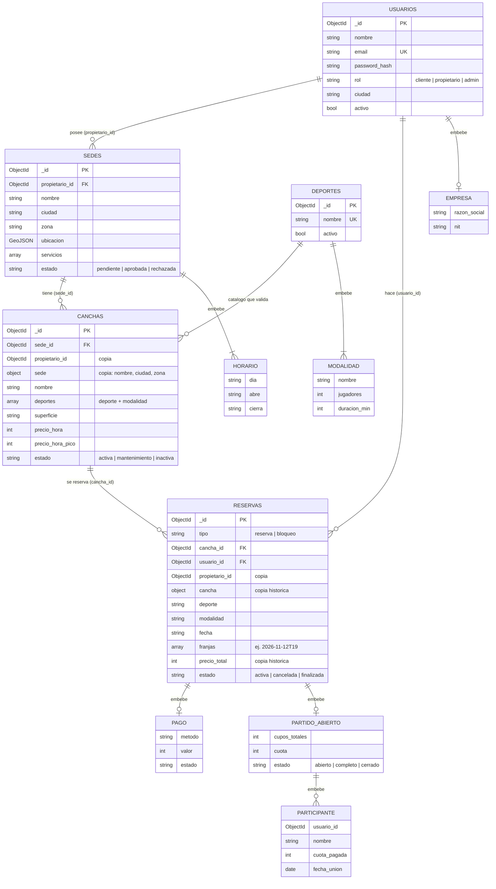

# Diagramas en Mermaid (respaldo)

Los diagramas oficiales están en draw.io (`D1` a `D6` en esta carpeta). Estos bloques Mermaid se conservan como respaldo: GitHub y Obsidian los dibujan solos.

## Arquitectura

## Modelo de datos

