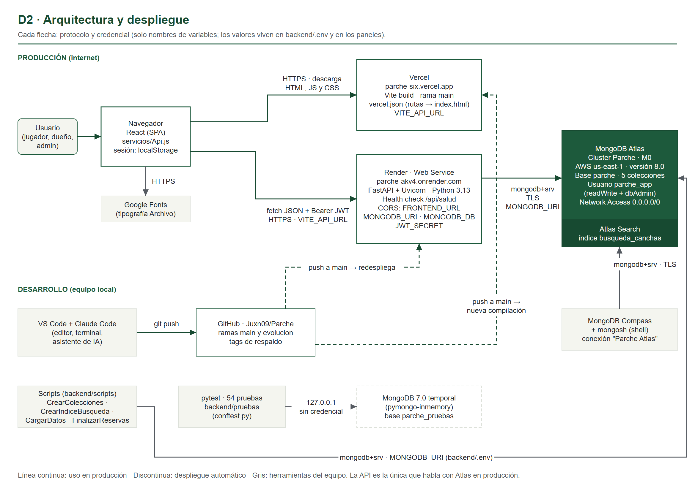
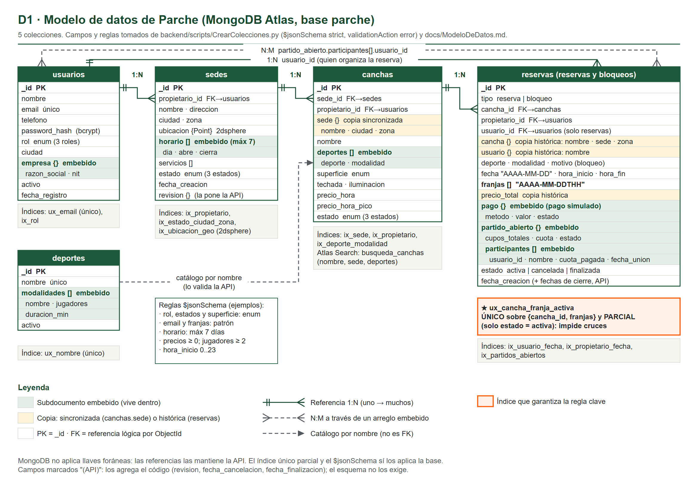

# Parte A — Guion para decir en voz alta

> Proyecto final de Bases de Datos II · Prof. Juan Carlos Gómez
> Integrantes: Juan Camilo Moreno, Marshall Robinson, Carlos Palacios

| Enlace | Dirección |
|---|---|
| Aplicación | https://parche-six.vercel.app |
| API (documentación) | https://parche-akv4.onrender.com/docs |
| Repositorio | https://github.com/Juxn09/Parche |

**Cómo usar este documento.** Esta parte es lo que se dice en voz alta, en orden, con las demos en su lugar. El detalle de cada herramienta está en la Parte B, las reglas, consultas y recorridos de código en la Parte C y los diagramas en la Parte D.

---


## 1. Apertura (~2 min)

**Ventana:** la app en https://parche-six.vercel.app (portada).

🗣 "Parche es un marketplace de reservas deportivas para Bogotá y Medellín. Resuelve un problema real: para jugar un partido hay que llamar a varias canchas, preguntar si hay hora, cuánto cuesta y, muchas veces, conseguir jugadores que falten."

🗣 "La web sirve a tres tipos de usuario:
- el **jugador** busca canchas por deporte, ciudad, precio y hora libre, reserva y paga (el pago es simulado), y puede abrir el partido para que otros se unan y paguen su parte;
- el **propietario** registra sus sedes y canchas, ve la agenda del día, bloquea horas y consulta reportes de su negocio;
- el **administrador** aprueba las sedes nuevas antes de que aparezcan en la búsqueda, desactiva usuarios y ve las métricas de toda la plataforma."

🗣 "Elegimos reservas deportivas porque el enunciado pedía un tema distinto al del Taller 3, que fue comercio electrónico, y porque tiene reglas de negocio interesantes para una base de datos: dos personas no pueden reservar la misma cancha a la misma hora, hay horas pico con otro precio y los partidos tienen cupos."

🗣 "Cumplimos la integración que pide el enunciado en tres capas: la **interfaz** en React, publicada en Vercel; la **API** en FastAPI, publicada en Render; y la **base de datos** en MongoDB Atlas, en la nube. La interfaz nunca habla con la base: siempre pasa por la API."

## 2. Arquitectura (~3 min)

**Ventanas:** diagrama D2, luego `/api/salud`, luego Atlas web.

Nota de versiones: la API corre en Render con **Python 3.13** (`backend/.python-version`); en el equipo de desarrollo se usa **Python 3.14**. Las 54 pruebas pasan en 3.14.



🗣 "El navegador carga la interfaz desde Vercel. Cada acción llama a la API con `fetch`, siempre desde un único archivo, `frontend/src/servicios/Api.js`, que agrega el token de sesión. La API valida, aplica las reglas y habla con Atlas usando PyMongo con un solo cliente. Atlas además tiene Atlas Search para la búsqueda por texto."

🗣 "Tenemos tres capas de defensa: la interfaz **orienta** (deshabilita horas ocupadas), la API **decide** (reglas y permisos) y la base **hace cumplir** lo crítico (validación `$jsonSchema` e índice único). Si alguien se salta la interfaz con Postman, la API y la base siguen protegiendo los datos."

**Demo A2.1 — la API está viva y conectada a Atlas.** Abrir https://parche-akv4.onrender.com/api/salud → `"estado": "ok"`, base `parche` y el conteo de cada colección. Mostrar `backend/app/Main.py:60` (ruta) y `:23` (si Atlas no responde, la API no arranca).

**Demo A2.2 — el cluster en la nube.** Atlas web → Clusters → `Parche`: M0 FREE, AWS N. Virginia (us-east-1), versión 8.0, réplica de 3 nodos, 1 índice de búsqueda.

## 3. Decisiones de modelado (~4 min)

**Ventanas:** diagrama del modelo, luego Compass.



*(Diagrama D1: las 5 colecciones con sus campos, subdocumentos embebidos, copias e índices. El código Mermaid de respaldo está en `docs/diagramas/Mermaid.md`.)*

🗣 "Usamos 5 colecciones: `usuarios`, `deportes`, `sedes`, `canchas` y `reservas`. La regla fue: **embebemos** lo que se lee junto y tiene tamaño acotado, y **referenciamos** lo que tiene vida propia o crece sin límite."

Ejemplos reales, uno por tipo de decisión:
- **Embebido — partido abierto en la reserva.** 🗣 "El partido nace y muere con la reserva y sus participantes están acotados por la modalidad, máximo 16. Unirse es una sola actualización atómica con `find_one_and_update`" (`backend/app/routers/Partidos.py:90`).
- **Referencia extendida — sede copiada en la cancha.** 🗣 "La cancha guarda `sede_id` y además una copia del nombre, ciudad y zona de la sede, para buscar sin `$lookup`. Si la sede cambia de nombre, la copia se sincroniza con `update_many`."
- **Copia histórica — precio y nombres en la reserva.** 🗣 "La reserva guarda el precio y los nombres del momento. Si mañana sube el precio, el historial no cambia."
- **Catálogo por nombre — deportes.** 🗣 "La cancha guarda el deporte y la modalidad como texto; al crearla, la API revisa que existan en el catálogo `deportes`" (`backend/app/routers/Propietario.py:57-66`).
- **Bloqueos dentro de `reservas`.** 🗣 "Un bloqueo del propietario es una reserva con `tipo: "bloqueo"`. Así el mismo índice impide reservar una hora bloqueada y bloquear una hora reservada."

🗣 "**Concurrencia:** cada reserva guarda sus horas como `franjas`, por ejemplo `2026-11-11T21`. El índice `ux_cancha_franja_activa` es **único** sobre `cancha_id` + `franjas` y **parcial**: solo cuenta las reservas `activa`. Si dos personas reservan la misma hora al mismo tiempo, la base acepta la primera y rechaza la segunda. Al cancelar, la reserva deja de ser activa y la hora se libera sola" (`backend/scripts/CrearColecciones.py:249`).

🗣 "**Validación:** cada colección tiene un `$jsonSchema` con `validationLevel: strict` y `validationAction: error` (`CrearColecciones.py:263-271`). Aunque alguien escriba directo en la base, sin pasar por la API, MongoDB rechaza el documento."

**Demo A3.1 — validación (no escribe nada).** Compass → *Open MongoDB shell*:
```
use parche
db.usuarios.insertOne({ nombre: "Prueba", email: "no-es-correo", rol: "superman" })
```
Debe salir `MongoServerError: Document failed validation`.

**Demo A3.2 — índices.** `db.reservas.getIndexes()` → señalar `ux_cancha_franja_activa` con `unique: true` y `partialFilterExpression: { estado: 'activa' }`.

## 4. Funcionalidades y recorrido de una reserva (~5 min)

**Ventana:** la app, con sesión de jugador.

**Demo A4.1 — buscar.** En "Todas las canchas", escribir `golaso` → aparecen las canchas de El Golazo y el aviso "Incluye resultados parecidos". Tocar el chip **Pádel**, luego **Hoy** y "Libre a las 9 p. m.". 🗣 "Cada filtro es un parámetro de `GET /api/canchas`. La búsqueda por texto usa Atlas Search, que tolera errores y tildes; si no encuentra nada, la API usa `$regex`" (`backend/app/routers/Canchas.py:26`).

**Demo A4.2 — reservar con hora pico (ESCRIBE EN ATLAS).** Abrir una cancha → elegir **pasado mañana o después** una hora con "Pico" → **Reservar y pagar**. 🗣 "La interfaz no envía el precio: lo calcula el servidor."

**El recorrido, de punta a punta** (diagrama D3). FastAPI revisa primero la sesión y después el cuerpo: sin token, la respuesta es 401 aunque el cuerpo esté mal.

| # | Capa | Qué pasa | Dónde mostrarlo |
|---|---|---|---|
| 1 | Regleta | Pinta cada hora con `GET /api/canchas/{id}/disponibilidad`: libre, pico, ocupada, elegida | `frontend/src/componentes/Regleta.jsx:17` |
| 2 | Interfaz | `reservar()` arma el cuerpo con `cancha_id`, `fecha`, `hora_inicio`, `horas`, `deporte`, `modalidad`, `metodo_pago`, `abierta`. Sin precio | `frontend/src/paginas/Detalle.jsx:110` |
| 3 | Api.js | `fetch POST /api/reservas` con `Authorization: Bearer <token>`; corta a los 45 s; si responde 401 cierra la sesión | `frontend/src/servicios/Api.js:24`, `:33`, `:62` |
| 4 | Permisos | `solo_cliente` verifica el JWT y el rol. Sin token 401; otro rol 403 | `backend/app/Seguridad.py:65` y `:85` |
| 5 | Pydantic | `ReservaEntrada` valida la forma (horas entre 1 y 3, fecha, método de pago). Si falla: 422 en español | `backend/app/Modelos.py:104` · `backend/app/Errores.py:89` |
| 6 | Reglas | Cancha activa de sede aprobada y propietario activo; ofrece esa modalidad; ni pasado, ni más de 30 días, ni fuera del horario; hora de Bogotá | `backend/app/routers/Reservas.py:36-62` y `:83-88` |
| 7 | Precio | Suma hora por hora: normal o pico (franjas de 6 a 9 p. m.) | `Reservas.py:94` · `backend/app/Utilidades.py:15` y `:61` |
| 8 | Base | `insert_one` con `franjas` y `estado: "activa"`; el índice único rechaza un cruce | `Reservas.py:132` |
| 9 | Respuesta | 201 con la reserva; si hubo cruce, `DuplicateKeyError` → 409 | `Reservas.py:133-135` |
| 10 | Interfaz | Muestra la confirmación; con 409 recarga la regleta | `Detalle.jsx:133` |

**Demo A4.3 — el documento en Atlas.** Compass → `reservas` → filtro `{ "usuario.nombre": "<nombre del jugador>" }` → ver `franjas`, `precio_total`, `pago` y la copia de `cancha`.
*Revertir:* desde **Mis reservas → Cancelar** (la API exige 24 h de anticipación; por eso se reserva para pasado mañana). La reserva queda `cancelada`, no se borra, y la hora se libera.

**Demo A4.4 — cruce rechazado (no escribe nada).** En `/docs`, como jugador, `POST /api/reservas` en una hora que la regleta muestra "Ocupada" → **409 "Ese horario ya está ocupado en esta cancha"**. El conteo de reservas en Compass no cambia.

**Demo A4.5 — propietario (ESCRIBE EN ATLAS).** Ingresar como propietario → **Mi panel → Agenda del día**: verde reserva, naranja partido abierto, rayado bloqueo. Tocar una hora libre y bloquearla. *Revertir:* tocar el bloqueo y quitarlo.

**Demo A4.6 — administrador (ESCRIBE EN ATLAS, opcional).** `GET /api/canchas?zona=Fontibón` → total 0. Como admin, aprobar la sede pendiente "Arena Sport Fontibón" → repetir la búsqueda → aparecen sus canchas. *Revertir:* en Compass, en `sedes`, cambiar `estado` de esa sede a `"pendiente"` (sirve también como demo de "modificar un registro").

## 5. Consultas y reportes (~3 min)

🗣 "Los reportes se calculan dentro de la base con Aggregation Pipeline. Son 9: 5 para el propietario y 4 para el administrador. Usan los operadores que pide el enunciado: `$match`, `$group`, `$project`, `$sort`, `$limit`, `$lookup` y `$unwind`, además de `$cond` y `$facet`" (`backend/app/routers/Reportes.py`; textos de cada consulta en `docs/Consultas.md`).

| # | Reporte | Pregunta que responde | Operadores clave |
|---|---|---|---|
| 1 | Mapa de calor | ¿A qué hora y día se llenan mis canchas? | `$match → $unwind → $project → $group` |
| 2 | Ingresos por sede y mes | ¿Cuánto factura cada sede? | `$group` sin `$lookup` (usa la copia) |
| 3 | Top 10 clientes | ¿Quiénes reservan más? | `$group → $sort → $limit → $lookup` |
| 4 | Cancelaciones | ¿Qué cancha tiene más cancelaciones? | `$group` con `$cond` |
| 5 | Subutilizadas | ¿Qué cancha casi no se usa? | desde `canchas` con `$lookup` a reservas |
| 6 | Deportes (admin) | ¿Qué deporte y modalidad se reservan más? | `$group → $sort` (desempate por nombre) |
| 7 | Zonas (admin) | ¿Qué zonas tienen más demanda? | `$group` con la copia `cancha.zona` |
| 8 | Partidos (admin) | ¿Se llenan los partidos abiertos? | `$facet` |
| 9 | Mensual (admin) | ¿Cómo crece la plataforma? | `$group` por mes con `$cond` |

**Demo A5.1 — reporte en vivo.** Compass shell: pegar el bloque "Antes de empezar" de `docs/Consultas.md` y luego el reporte 7 → Kennedy primero. 🗣 "No necesita `$lookup` porque cada reserva ya trae la zona copiada."

**Demo A5.2 — dashboards.** App → **Mi panel → Reportes** (propietario): mapa de calor y la hora más llena; luego **Administración → Métricas**.

## 6. Calidad: pruebas y errores (~2 min)

🗣 "Tenemos 54 pruebas automáticas con pytest. Corren contra un MongoDB real temporal, con los mismos validadores e índices, nunca contra Atlas. No usamos mongomock porque no aplica índices únicos sobre arreglos: con él, un cruce parcial de horas pasaba sin error."

| Archivo | Pruebas | Qué cubre |
|---|---|---|
| `PruebaReservas.py` | 13 | Cruces parciales y simultáneos, bloqueos, precio pico del servidor, pasado/30 días/horario, cancelación con 24 h, finalización idempotente, `$jsonSchema` |
| `PruebaLibresHoy.py` | 15 | Horas libres de hoy, horas pasadas, sede cerrada, ids inválidos, hora de Bogotá |
| `PruebaPaginacion.py` | 9 | Páginas sin repetidos ni perdidos con empates |
| `PruebaSeguridad.py` | 9 | 401/403, token falso, sin registro como admin, correo repetido, aislamiento entre propietarios, propietario desactivado, rechazo de sede con confirmación |
| `PruebaPartidos.py` | 7 | Cupo con uniones simultáneas, cuota, salir, partidos finalizados o cancelados |
| `PruebaReportes.py` | 1 | Reporte de deportes con desempate estable |

**Demo A6.1 — correr las pruebas.** VS Code, terminal en `backend` (con el `.venv` activo): `python -m pytest` → debe terminar con "54 passed". Tarda unos 2 minutos (levanta un MongoDB temporal). (No agregar `-q`: `pytest.ini` ya lo trae y con dos se oculta el resumen.)

🗣 "Y los errores siempre llegan en JSON y en español: un dato mal enviado da 422 con el campo que falló; si Atlas no responde, 503; sin sesión, 401" (`backend/app/Errores.py`, registrado en `Main.py:37-38`).

## 7. Cierre (~1 min)

🗣 "En resumen: el modelo documental encaja con el negocio, la integridad crítica la garantiza la base de datos y no el código, los reportes responden preguntas reales del dueño y del administrador, y todo está en internet sin credenciales en el repositorio. Quedamos atentos a sus preguntas."

## 8. Qué le va a interesar al profesor (por criterio)

### Criterio 1 — Diseño de la solución y modelo de datos
| Pregunta probable | Qué quiere oír | Respuesta modelo |
|---|---|---|
| ¿Por qué embebieron el partido y no hicieron otra colección? | Que la decisión depende de cómo se lee y del tamaño | "Se lee siempre con la reserva y está acotado a 16 jugadores; así unirse es una sola operación atómica." |
| ¿Por qué hay datos repetidos? | Que cada copia tiene una regla | "La sede en la cancha se sincroniza; el precio en la reserva es histórico a propósito." |
| ¿Cómo evitan dos reservas a la misma hora? | Que lo hace la base, no un if | "Índice único parcial sobre cancha y franjas; la base rechaza la segunda inserción." |
| ¿Por qué MongoDB y no SQL? | Ajuste al caso, no moda | "Una reserva con su pago y su partido se lee en una consulta; Atlas además da Atlas Search y validación." |

### Criterio 2 — Desarrollo e integración
| Pregunta | Respuesta modelo |
|---|---|
| ¿Cómo se comunica la interfaz con la base? | "Nunca directo: Api.js llama a la API con el token; la API usa PyMongo con un solo cliente." |
| ¿Dónde están las validaciones? | "En tres capas: la interfaz orienta, Pydantic y las reglas en la API deciden, `$jsonSchema` e índices en la base." |
| ¿Cómo sabe la API quién soy? | "Un JWT firmado con HS256 que dice el id y el rol; en cada petición se consulta que el usuario siga activo." |
| ¿Qué pasa si se cae Atlas? | "La API responde 503 en JSON y la interfaz muestra el mensaje; al arrancar, si no hay conexión, la API no inicia." |

### Criterio 3 — Consultas y uso de la información
| Pregunta | Respuesta modelo |
|---|---|
| Explique un pipeline | Usar el reporte 1 o el 7 (tabla de la sección 5) y decir qué hace cada etapa. |
| ¿Para qué le sirve esto al dueño? | "Ver las horas pico para ajustar precios y las canchas subutilizadas para promocionarlas." |
| ¿La búsqueda es eficiente? | "`libres-hoy` hace una sola consulta con `$in` y usa el índice único: examina 5 de 964 documentos (explain en Atlas)." |

### Criterio 4 — Sustentación y dominio
| Pregunta | Respuesta modelo |
|---|---|
| Describa el recorrido de una operación | La tabla de 10 pasos de la sección 4. |
| ¿Dónde se guarda el precio de una reserva? | "En `reservas.precio_total` y en `reservas.pago.valor`, calculado en `Reservas.py:94`." |

### Cambios sencillos en vivo (los que menciona el enunciado)
| Pedido | Dónde | Qué hacer |
|---|---|---|
| Modificar un registro | Compass → colección → editar documento | Ej.: en `sedes`, cambiar `estado` de una sede; el `$jsonSchema` rechaza valores fuera de la lista |
| Cambiar una condición de búsqueda | `backend/app/routers/Canchas.py` (función de `GET /api/canchas`) | El diccionario `filtro` que va a `find()`; ej. `filtro["precio_hora"] = {"$lte": precio_max}` |
| Explicar una consulta | `backend/app/routers/Reportes.py` y `docs/Consultas.md` | Reporte 1 (línea 57) o 7 (línea 220) |
| Identificar dónde se almacena un dato | `docs/ModeloDeDatos.md` | Ej.: el horario de una sede está embebido en `sedes.horario` |
| Describir el recorrido de una operación | Tabla de la sección 4 | De `Detalle.jsx:110` a `Reservas.py:132` |
| Cambiar la hora pico | `backend/app/Utilidades.py:15` | `HORA_PICO = range(18, 22)` (y `esPico` en `Regleta.jsx:15`) |
| Cancelar con 12 h en vez de 24 | `backend/app/routers/Reservas.py:28` | `HORAS_MINIMAS_CANCELAR` |
| Top 5 en vez de top 10 | `backend/app/routers/Reportes.py:123` | `{"$limit": 10}` de `mejores_clientes` |

Después de cambiar el backend: correr las pruebas; si la regla cambió a propósito, la prueba que la cubre debe fallar y ajustarse.

## 9. Mapa contra el enunciado

| Requisito del enunciado | Dónde se cumple | Demo que lo prueba | Estado |
|---|---|---|---|
| Base de datos en la nube | MongoDB Atlas M0, AWS N. Virginia | A2.2, A3 | ✅ Verificado |
| Backend/API que procesa, valida y opera | FastAPI en `backend/app`, 41 rutas | A4.2, A4.4 | ✅ |
| Credenciales fuera del repositorio | `.gitignore`, `.env.example`, variables en Render | Parte B, ficha "python-dotenv, .env…" · demo `git check-ignore` | ✅ (`git check-ignore`) |
| Desplegada y accesible desde internet | Vercel + Render | A2.1, apertura | ✅ 200 sin sesión en `parche-six` |
| Interfaz gráfica | React en `frontend/src` | Toda la Parte A | ✅ |
| Creación, consulta, actualización, eliminación | Sedes y canchas (`/api/propietario/*` con POST, GET, PUT, DELETE); reservas, bloqueos, usuarios | A4.2, A4.5 | ✅ |
| Búsqueda y filtrado | `GET /api/canchas` + Atlas Search | A4.1 | ✅ |
| Relaciones con información comprensible | Referencias extendidas y `$lookup` | A4.3, A5 | ✅ |
| Validaciones y reglas de negocio | Pydantic, `Reservas.py`, `$jsonSchema`, índices | A3.1, A4.4 | ✅ |
| Embedding y referencing justificados | `docs/ModeloDeDatos.md`, sección 3 | A3 | ✅ |
| Consultas con valor (Aggregation) | 9 reportes en `Reportes.py` | A5 | ✅ |
| Documentación de 14 puntos + enlaces | `docs/DocumentoTecnico.md` y su PDF | — | 🟡 Los 14 puntos están cubiertos (aprendizajes incluidos en la sección 12). Faltan evidencias: E6, un pipeline en Compass y los paneles de Render y Vercel |
| Tema distinto al Taller 3 | Reservas deportivas | Apertura | ✅ |
| Trabajo en parejas | Somos tres | — | ⚠️ Confirmar con el profesor |
| **Criterio:** diseño y modelo | Sección 3 | A3 | ✅ |
| **Criterio:** desarrollo e integración | Secciones 2 y 4 | A4 | ✅ (login y reserva en producción: los prueba el usuario) |
| **Criterio:** consultas | Sección 5 | A5 | ✅ |
| **Criterio:** sustentación | Todo el guion | — | Depende del ensayo |

## 10. Reparto entre integrantes

El enunciado pide que **cada integrante domine el proyecto completo**, aunque se repartan los bloques. Este reparto es solo una propuesta para llenar:

| Bloque | Tiempo | Expone | Respaldo (si pregunta el profesor) |
|---|---|---|---|
| 1. Apertura | 2 min | ______ | ______ |
| 2. Arquitectura | 3 min | ______ | ______ |
| 3. Modelado | 4 min | ______ | ______ |
| 4. Funcionalidades y recorrido | 5 min | ______ | ______ |
| 5. Consultas y reportes | 3 min | ______ | ______ |
| 6. Calidad | 2 min | ______ | ______ |
| 7. Cierre | 1 min | ______ | ______ |
| Preguntas y cambios en vivo | 5–10 min | Todos | — |

Ensayo sugerido: que cada uno haga al menos una vez la demo de otro bloque.

## 11. Plan B

| Si pasa esto | Qué hacer |
|---|---|
| **Render dormido** (la primera respuesta tarda ~1 min) | Abrir `/api/salud` 5 minutos antes y dejar la pestaña abierta. Si tarda en vivo, decir: "es el plan gratuito, se despierta en un minuto" y seguir con el diagrama |
| **Atlas no conecta desde la red del salón** | Antecedente real: desde otra red, la API local y Compass fallaron con un error de handshake TLS (`SSL handshake failed ... tlsv1 alert internal error`) **incluso con `0.0.0.0/0` en Network Access**. La causa no se determinó; hipótesis: un proxy o firewall que inspecciona TLS, un cambio de Network Access que aún no se había propagado, o un bloqueo del proveedor de internet. Lo que depende de la red del salón es **Compass y la API local** del portátil; la app publicada (navegador → Vercel → Render → Atlas) no pasa por esa red para llegar a Atlas. Si falla: hotspot del celular; si sigue fallando, mostrar los datos desde la app publicada, `/api/salud` y las capturas E1, E2 y E7 |
| **Vercel no carga** | Correr la interfaz local (`npm run dev` en `frontend`, http://localhost:5173) apuntando a Render, o mostrar las capturas E8, E9 y E11 |
| **Se cae el Wi-Fi** | Hotspot del celular. Si no hay internet: mostrar el PDF del documento técnico (capturas de cada pantalla) y correr las 54 pruebas, que no necesitan internet |
| **Una demo que escribe en Atlas falla a mitad** | Revisar en Compass el estado del documento y revertir como dice cada demo |

Tener abiertas, por si acaso, las capturas de `Evidencias/Documento/` de la bóveda.

## 12. Orden de ventanas y tiempos

**Antes de empezar (10 minutos antes), en este orden:**
1. Navegador, pestaña 1: https://parche-akv4.onrender.com/api/salud (despierta Render; esperar `"estado": "ok"`).
2. Pestaña 2: https://parche-six.vercel.app con sesión de **jugador**.
3. Pestaña 3 (ventana privada): la app con sesión de **propietario**; luego de **admin** si se hace la demo A4.6.
4. Pestaña 4: https://parche-akv4.onrender.com/docs.
5. Pestaña 5: Atlas web en Clusters.
6. Compass conectado a **Parche Atlas**, con el shell abierto en `use parche`.
7. VS Code en el repositorio, con `Reservas.py`, `CrearColecciones.py` y `Reportes.py` abiertos, y una terminal en `backend`.
8. Este guion y el PDF del documento técnico.

**Línea de tiempo (~20 min + preguntas):**

| Minuto | Bloque | Ventana principal |
|---|---|---|
| 0–2 | Apertura | App (portada) |
| 2–5 | Arquitectura | Diagrama → `/api/salud` → Atlas |
| 5–9 | Modelado | Diagrama → Compass |
| 9–14 | Funcionalidades y recorrido | App → Compass → `/docs` → VS Code |
| 14–17 | Consultas y reportes | Compass → App (paneles) |
| 17–19 | Calidad | VS Code (terminal) |
| 19–20 | Cierre | App |
| 20+ | Preguntas y cambios en vivo | Según la pregunta |

## 13. Si preguntan qué no hace el sistema

🗣 "Somos honestos con los límites: el pago es simulado, la finalización de reservas se ejecuta a mano, el NIT del propietario no se valida contra ninguna fuente, no limitamos los intentos de login y el catálogo de deportes se referencia por nombre. Lo primero que mejoraríamos es un pago real, la finalización automática y la seguridad del login." (Detalle y mejoras: Parte C, sección C4.)
