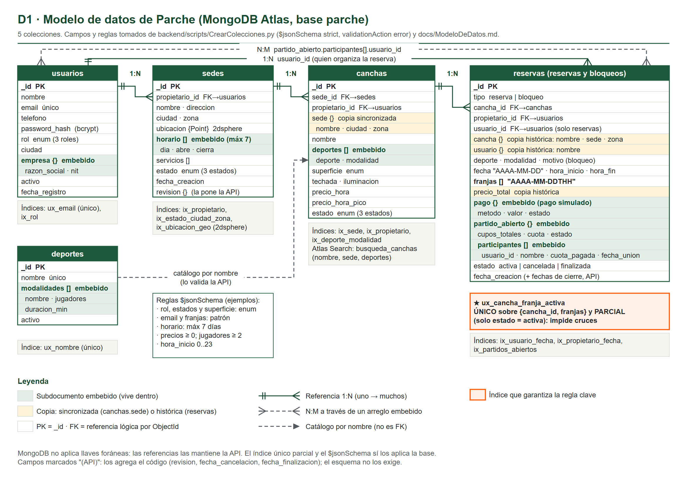
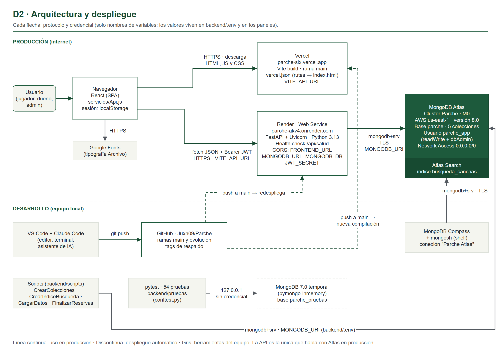
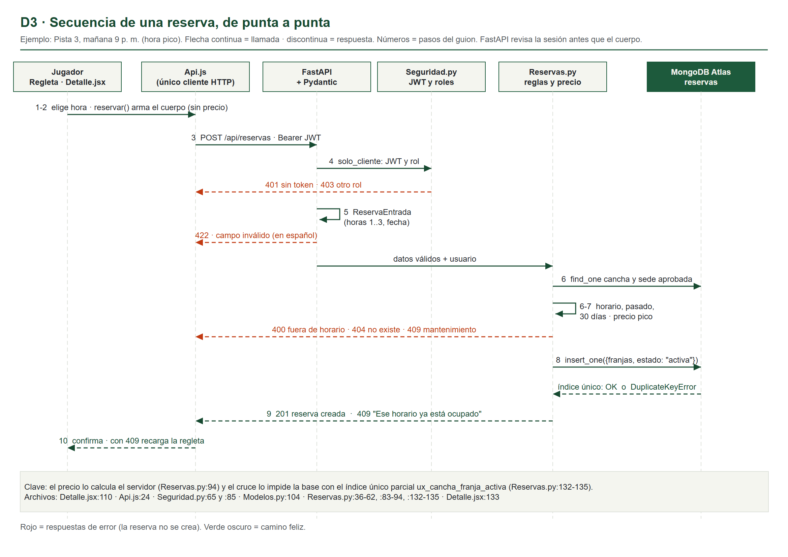
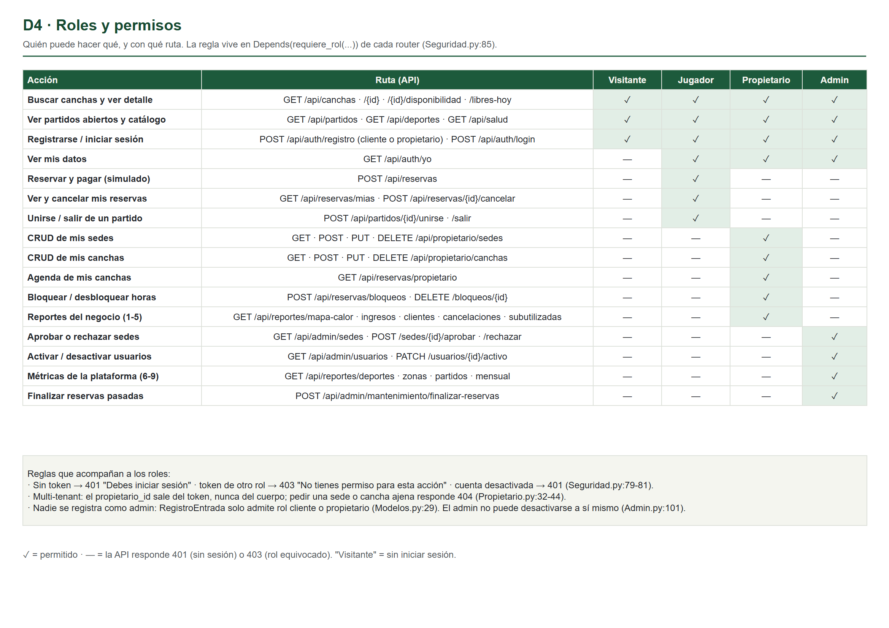
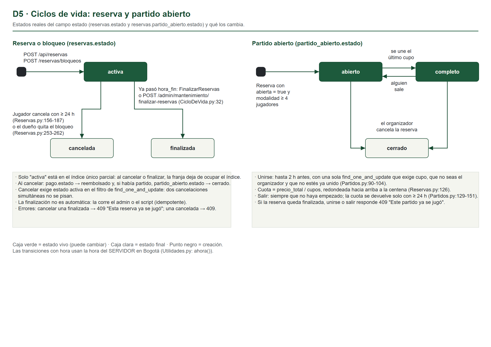
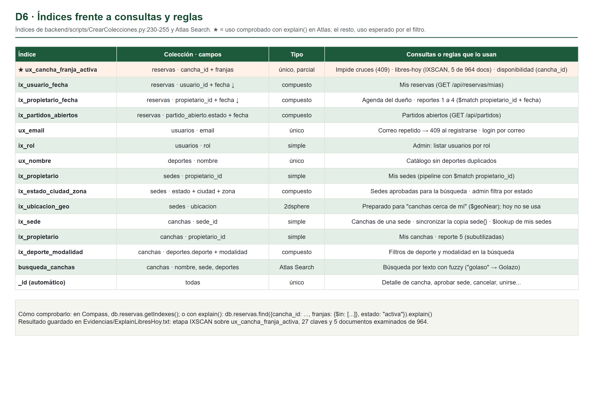

# Parte D — Diagramas (draw.io)

Seis diagramas en tamaño A4 horizontal, con la paleta de Parche (grama `#1d5a3c`, tiza `#f4f5ef`, acento `#ff6a1f` solo para lo clave). Cada uno existe en tres formatos en `docs/diagramas/` (y en `Diagramas/` de la bóveda):

| Diagrama | Archivo editable | Imagen |
|---|---|---|
| D1 · Modelo de datos completo | `D1-ModeloDeDatos.drawio` | `.png` y `.svg` |
| D2 · Arquitectura y despliegue | `D2-ArquitecturaDespliegue.drawio` | `.png` y `.svg` |
| D3 · Secuencia de una reserva | `D3-SecuenciaReserva.drawio` | `.png` y `.svg` |
| D4 · Roles y permisos | `D4-RolesPermisos.drawio` | `.png` y `.svg` |
| D5 · Ciclos de vida | `D5-CiclosDeVida.drawio` | `.png` y `.svg` |
| D6 · Índices frente a consultas | `D6-IndicesConsultas.drawio` | `.png` y `.svg` |

**Cómo se generaron.** En el equipo no hay draw.io instalado. Un script describe cada diagrama una sola vez (posiciones, textos, líneas) y escribe a la vez el `.drawio` y el `.svg`; Chrome sin ventana convierte el SVG en PNG. Las imágenes de esta guía son esos PNG. El `.drawio` usa la misma geometría.

**Cómo abrirlos y exportarlos tú.**
1. Entra a https://app.diagrams.net (o instala draw.io Desktop).
2. *File → Open from → Device* y elige el `.drawio`.
3. Edita lo que quieras.
4. *File → Export as → PNG* (marca *Transparent background* desmarcado y *Zoom 200 %*) o *SVG*.
5. Guarda con el mismo nombre en `docs/diagramas/` para reemplazar la imagen.

**Fuentes de los datos.** D1 sale de `backend/scripts/CrearColecciones.py` (esquemas e índices) conciliado con `docs/ModeloDeDatos.md`; D3 a D6, del código de los routers (archivo y línea en cada diagrama y en la Parte C). El código Mermaid anterior se conserva como respaldo en `docs/diagramas/Mermaid.md`.

**Cómo leerlo:** cada tabla es una colección; las filas verdes claras son subdocumentos embebidos; las amarillas, copias (sincronizada en `canchas.sede`, históricas en `reservas`). Las líneas con pata de gallo son referencias 1:N; la discontinua de arriba es la relación N:M que se forma con `partido_abierto.participantes`. El recuadro naranja es el índice que impide cruces.

**Conciliación de las dos versiones del modelo:** la versión simplificada del documento técnico (relación "organiza") y la completa de `ModeloDeDatos.md` (relación "hace") se unificaron; D1 usa los campos del `$jsonSchema` real. Se agregaron, marcados "(API)", los campos que pone el código y el esquema no exige: `sedes.revision`, `reservas.fecha_cancelacion` y `reservas.fecha_finalizacion`.

